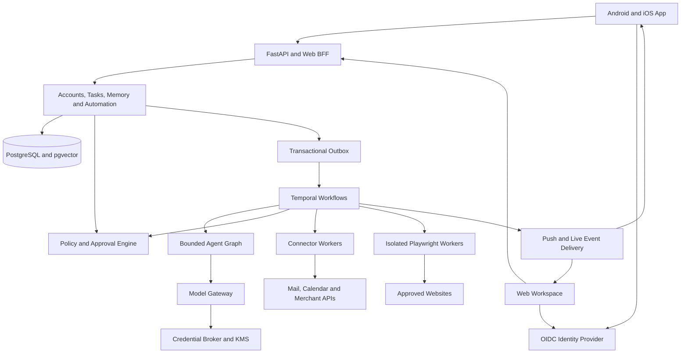
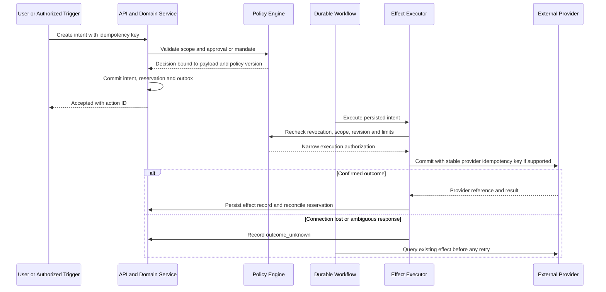

# Dayloom Product Architecture

Status: target architecture with an unreleased implementation in progress. The
shipped v0.1 is still a single-user prototype. The next section records actual
source implementation; the target sections below are not a claim of delivery.

## Unreleased Implementation Status

| Area | Implemented source | Remaining release gate or scope |
| --- | --- | --- |
| Identity and data | OIDC Code/PKCE, native PKCE handoff, hashed/rotating/revocable sessions, workspace-scoped ORM, Alembic, forced PostgreSQL RLS and runtime-role checks | Real PostgreSQL/Keycloak deployment, backchannel logout, full account deletion, security review |
| Model configuration | Per-workspace encrypted BYOK, approved HTTPS origins, request quotas, output-token bounds, visible unconfigured state | Live provider validation, monetary accounting, streaming, KMS |
| Mail and automation | TLS SMTP, exact-content approval, finite expiring schedules, pause, durable effect-start marker, unknown-outcome no-replay and owner-reported resolution | Provider OAuth, delivery verification, dynamic mandates, generalized compensation |
| Browser | Separate authenticated runner for approved public HTTPS page reads, fresh sandboxed Chromium, JavaScript disabled | Actual runner/network isolation verification; no authenticated browsing, arbitrary clicks or checkout |
| Native | Capacitor App/Browser login, Android Keystore and iOS Keychain bridges, opt-in local Android notification capture, manual artifact workflow | Native compilation, device tests, signing/distribution, app links, push, share extensions, offline sync |
| Commerce | No purchase connector | Authorized merchant selection, sandbox, payment grants, exact quote/budget rules and explicit purchase approval |

The current scheduler remains database-backed, not Temporal or LangGraph. The
credential vault uses an externally supplied Fernet key in account mode, not KMS
envelope encryption. Android bridge source follows the existing Java project;
iOS uses Swift. Most HTTP routes remain under `/api`, not the complete proposed
versioned API. Default model selection is now `UnconfiguredProvider`; tests and
intentional local demos select `DemoProvider` explicitly.

Local verification and unverified environments are recorded in
[VERIFICATION.md](VERIFICATION.md). Actual configuration, deployment limits and
native artifact prerequisites are in [OPERATIONS.md](OPERATIONS.md) and
[MOBILE.md](MOBILE.md). No live email, purchase or public deployment is implied.

## Shipped v0.1

### Boundaries

The React/Vite client speaks HTTP to FastAPI. PostgreSQL or SQLite owns the
workspace state. An independent worker executes approved local tools. The browser
does not own jobs, model keys or approval policy. It polls for current state.

The v0.1 runtime deliberately uses database-backed jobs instead of adding Redis,
Celery and an agent graph before there are multi-step workflows. The model layer
is a replaceable adapter. LangGraph can later implement a multi-step runner behind
the same action boundary; the current version does not claim to use it.

Modules:

- `backend/dayloom/api.py`: authenticated HTTP boundary and explicit user actions.
- `db.py`: typed persistence and metadata-only audit records.
- `policy.py`: deterministic content hash and exact approval check.
- `planning.py`: rule baseline for priority, deadlines, capacity and free intervals.
- `worker.py`: claims, leases, recovery and local transactions.
- `registry.py`: decorator registration, module discovery and constructor injection.
- `providers/`, `tools/`, `connectors/`: independently registered implementations.
- `apps/web`: client, browser tests and Capacitor configuration.

### Action lifecycle

`pending -> queued -> running -> succeeded | failed`

User approval records a SHA-256 digest of canonical tool name and validated
payload. Editing a pending/queued/failed action clears approval and returns it to
pending. A failed action can be retried only after returning to review. Cancellation
is supported before execution; running database transactions are not interrupted.

The worker claims jobs with a conditional update and a lease, then verifies the
approved hash again. Current tools and success records commit in one transaction.
An abandoned lease can be reclaimed; recovery attempts are bounded. The initial
release supports one worker per SQLite database. PostgreSQL is the scale-up path.

Do not add network side effects inside these database transactions. A sending or
publishing tool needs durable intent, provider idempotency keys, uncertain-outcome
reconciliation and approval bound to the exact recipient and body. A browser agent
also needs isolation, credential brokering, resource budgets and human takeover.

### Data contracts

Task status is user-work status; action status is AI-execution status. They are
different objects. A task is never marked done just because a model said so.
Memory has content, source, category, version and optional expiry. Expired memory
is excluded from model context. User edits are the source of truth.

The database is authoritative. JSON exports are portable snapshots, not a second
live database. Markdown import/export and semantic indexing are follow-ups.
Deleting a memory is not deleting all source evidence: chats and action history
remain unless the entire workspace is erased. Backups have independent retention.

### First acceptance gates

| Slice | Baseline/check | Pass condition |
| --- | --- | --- |
| Planning | Deadline/priority rule baseline, identical input | No event overlap or capacity overflow; no past blocks |
| Approval | Before/after payload mutation | Old approval never executes changed content |
| Recovery | Expired worker lease | One local effect and a persisted result |
| Retry | Failure to review to fresh approval | No retry without renewed approval |
| Memory | CRUD, expiry and model-context capture | Deleted/expired record absent from active memory context |
| Calendar | Repeated and malformed ICS imports | No duplicates; failed import preserves previous snapshot |
| Security | Token checks, hostile origins, preflight | Protected requests reject; allowed native preflight works |
| Client | Desktop/mobile browser flows | CRUD, proposal approval, execution visibility, no horizontal overflow |

Future model experiments must first run the same-input rule baseline and define
the comparison matrix. Do not call a model plan better based on different data,
budgets or evaluators. Remote model quality is not certified by the offline suite.

### Original follow-ups

1. OAuth read-only connector and explicit source revocation.
2. Follow-up objects, event triggers, recurring schedules and notification budgets.
3. Migration tooling, per-user identity and robust offline conflict resolution.
4. Native secure storage, sharing, calendar and push adapters.
5. Multi-step runner and isolated browser execution after effect-safety tests exist.

## Target Product

### Product contract

Ship installable Android and iOS clients backed by a real account system, real
model APIs and server-side execution. A mobile client is not the always-on agent:
scheduled work continues on the server while the client is closed. Native device
permissions and store policies still apply; an LLM cannot grant itself access.

The production user journey is: install, sign in, create a personal workspace,
connect a model, authorize integrations, define automation rules, and inspect or
approve actions. Missing model configuration produces an explicit setup state,
not an automatic fallback to the demo provider.

### Architecture decisions

| Area | Decision | Reason and boundary |
| --- | --- | --- |
| Mobile UI | Keep React and Capacitor; add real Swift/Kotlin platform modules | Reuse the current client while delivering signed native packages. The UI remains WebView-rendered; this is not a claim of fully native UI. |
| Native capabilities | Secure storage, app links, share extensions, push and Android notification listener | Implement and test platform behavior rather than shipping an unchanged web wrapper. |
| Web | Retain the responsive client for desktop access and account administration | Share product logic and API types; use platform adapters for device-only capabilities. |
| API | FastAPI modular monolith, versioned REST and SSE | Keep domain boundaries explicit without prematurely creating a large microservice estate. |
| Identity | OIDC provider, initially Keycloak; Authorization Code with PKCE | Do not implement password storage or OAuth flows from scratch. Identity-provider deployment can be replaced without changing domain ownership. |
| State | PostgreSQL, SQLAlchemy and Alembic | Multi-user constraints, migrations, transactional intent and row-level defense in depth. SQLite remains a local client cache or explicit single-user legacy mode. |
| Models | Internal Model Gateway using maintained provider adapters such as LiteLLM | Per-workspace BYOK, structured outputs, streaming, quotas and provider-specific capabilities; no model gets execution authority. |
| Agent reasoning | Bounded LangGraph graph inside workflow activities | Planning and tool selection are separate from authorization and durable scheduling. |
| Durable execution | Temporal workflows, schedules, signals and activity workers | Own the lifecycle of long-running work, approvals and recovery. No second competing scheduler or job state machine in the agent graph. |
| Retrieval | PostgreSQL plus pgvector | Keep workspace filters, source provenance and deletion controls close to authoritative data. |
| Transient state | Redis | Rate limits, short-lived coordination and caches; never the sole record of an approval or purchase. |
| Files | S3-compatible private object storage | Attachments, receipts and browser evidence use scoped, expiring access URLs. |
| Secrets | KMS-backed envelope encryption; self-hosted secret service as an alternative | Store encrypted user credentials separately from model context and application logs. |
| External execution | Dedicated connector workers and isolated Playwright browser workers | Network side effects do not run inside API database transactions or native UI processes. |
| Operations | OpenTelemetry, structured redacted logs, metrics and release gates | Make failures, spending and action outcomes visible without logging private content. |

These are logical components, not a requirement for a separate service per table.
Initially deploy the API, workflow/connector workers, browser workers and required
infrastructure as a small number of independently permissioned process groups.



The executor must recheck the same authorization policy immediately before an
external commit. A model proposal, a notification, a workflow retry or an incoming
email is never an approval. Native prompts and financial confirmation are not
silently replaced by model decisions.

### Migration principle

Preserve the current prototype as an explicitly named development mode while
building the production path. Do not silently adopt existing local data into the
first account that signs up. An administrator must explicitly migrate it into an
identified personal workspace after backup and validation.

Keep the existing registry pattern: new model providers, tools, connectors and
workflow types are modules with registration and validated configuration. Do not
turn the current API file into a set of account, provider and platform switches.

## Identity and Data Isolation

Dayloom login, connected mail accounts, merchant authorization and model API
credentials are four separate grants. Signing in with Google does not authorize
reading Gmail, sending mail, spending money or using a model provider.

- Use OIDC Authorization Code with PKCE, state and nonce. Native sign-in opens the
	system authentication browser, not a credential-capturing embedded WebView.
	Verify issuer, audience, signature, expiration and session validity server-side.
- Offer verified email sign-in and identity-provider-managed passkeys/MFA. Add
	Google and Apple federation through the identity provider. Account linking
	requires authentication of both identities, not matching an unverified email.
- Use verified app/universal links for native callbacks. Keep short-lived access
	tokens in memory and rotating refresh credentials in Keychain/Keystore-backed
	storage. Capacitor Preferences, localStorage and sessionStorage are not a
	production credential vault.
- Web sessions use Secure, HttpOnly cookies through the BFF, explicit CSRF
	protection and constrained origins. Do not expose refresh tokens to web scripts.
- A user initially owns one personal workspace. Every user-owned row, object,
	cache entry, vector, event, workflow and browser session carries its workspace
	identity. Sharing with other users is not enabled by default.
- Derive the principal from verified authentication. Treat a workspace ID in a
	request as a selector, never as proof of membership. Check ownership on every
	resource, including exports, SSE replay, attachments and background activities.
- Enforce PostgreSQL RLS with a non-owner application role that cannot bypass it.
	Set workspace context transaction-locally and reset pooled connections. Add
	composite workspace foreign keys and workspace-scoped unique constraints.
	RLS supplements application authorization; it does not replace it.
- Provide device/session lists, remote logout, refresh-token revocation and
	account deletion. Step-up authentication protects credential changes, new
	purchase mandates and high-risk approvals. A local biometric unlock alone is
	not evidence of fresh server-side authorization.
- Operators get redacted diagnostics by default, not unrestricted mailbox or
	memory access. Any exceptional support access is time-limited and audited.

## Model Gateway and Memory

### Real model connections

The App exposes a model-connection screen: provider, approved endpoint, model,
secret entry, capability test, allowed data categories and spending limits.
Production has no implicit DemoProvider. Keep demo fixtures only in an explicitly
labeled development/test profile; missing or failed credentials must be visible.

- Support BYOK per workspace. Store a secret reference, provider, endpoint,
	model identifier, capabilities, consent version and status; never return the
	original API key after submission. Delete/revoke/rotate are first-class actions.
- Encrypt credentials with an individual data key wrapped by KMS. Separate the
	decryption role from ordinary API read access. OAuth refresh tokens, browser
	session cookies and model keys use separate credential purposes and ACLs.
- Initially support a verified OpenAI-compatible provider, then adapters for
	other providers such as Anthropic and Gemini. Capability checks cover tool
	calling, structured outputs, streaming, vision and embedding compatibility;
	an arbitrary model name does not imply support for all of them.
- Hosted deployments start with approved provider origins. Custom compatible
	endpoints require explicit enablement, HTTPS and an egress policy covering
	DNS resolution, redirects, IPv4/IPv6, private ranges and cloud metadata. Do not
	turn a user-configurable base URL into an SSRF proxy. Self-hosted private-model
	endpoints require an administrator-defined network exception.
- Bind each credential to its provider origin. Endpoint changes invalidate the
	connection's credential binding and consent; do not forward authorization
	headers to a new redirect destination or silently reuse another provider's key.
- The gateway performs schema validation, bounded context assembly, token and
	concurrency limits, timeouts, accounting and circuit breaking. Reserve a
	conservative maximum request cost atomically and settle actual reported usage;
	estimates and provider invoices are distinguished. Fail closed if budget
	enforcement is unavailable. Fallback to another provider requires prior consent.
- Stream responses through authenticated server events. Persist request/run IDs,
	model/version, usage, latency and error class; exclude raw keys and private
	prompts from default telemetry. Provider errors never become fake success.
- Model calls and tool calls are separate capabilities. The model cannot obtain
	a credential, change a policy, approve its own action or access unrestricted
	shell execution. Untrusted email, documents, notifications and webpages remain
	data even if they contain instructions addressed to the assistant.
- Model API access and billing are independent from subscriptions to consumer
	chat products. BYOK also does not exempt Dayloom's own digital subscriptions
	from applicable app-store billing rules.

### Memory and planning

Use three explicit stores: working conversation context, user-confirmed long-term
memory, and source documents/events with provenance. The model may suggest a
memory; persistence follows an explicit save or a scoped user-enabled capture rule.
It must not silently convert every notification into permanent personal memory.

Retrieve with workspace and access filters before ranking. Combine keyword and
vector retrieval, preserve source IDs, expiry and sensitivity, and record which
sources were actually used. Embedding provider changes require versioned indexes
and re-embedding; do not mix incompatible vectors. Export, correction and deletion
cover source records, chunks, indexes, caches and derived summaries, with a stated
backup retention policy. The product cannot promise deletion at external providers.

Use the existing deterministic planner as a constraint checker and baseline.
The LLM can interpret intent, estimate subtasks and explain choices; validated
constraints still enforce calendar availability, dependencies and capacity. Add
goals, task dependencies and follow-up records with waiting conditions, next-check
times, maximum reminders and quiet hours. Calendar connectors need OAuth scopes,
webhook renewal, cursor-based sync and conflict rules; ICS remains an import path.

## Domain Model and API

The following are proposed aggregates, not tables already present in v0.1.

| Domain | Principal records | Required invariant |
| --- | --- | --- |
| Identity | users, external identities, workspaces, memberships, devices, sessions | No access without a currently authorized principal and workspace |
| Productivity | goals, tasks, dependencies, follow-ups, calendar accounts/events | Task completion is separate from execution outcome |
| Intelligence | conversations, messages, memories, source documents, chunks, model connections | Provenance, per-workspace access, expiry and consent accompany content |
| Automation | automation rules, trigger events, workflow runs, action intents, action revisions | Every effect has one durable logical intent and a versioned payload |
| Authorization | policies, automation mandates, approvals, budget reservations | No self-approval; limits and revocation checked at commit time |
| Integrations | connections, credential references, sync cursors, webhook inbox | Provider account and scope are bound to one authorized workspace |
| Effects | execution attempts, external effect ledger, email records, orders, receipts | A timeout is not evidence that an effect did not happen |
| Evidence | audit events, artifacts, export/deletion jobs, usage ledger, transactional outbox | Audit metadata and queued work survive process failure |

Version production endpoints under `/api/v1`. Generate client types from OpenAPI
and maintain compatibility for released mobile versions. Proposed route groups:

| Route group | Responsibility |
| --- | --- |
| `/me`, `/devices`, `/sessions` | Identity, device enrollment and session management |
| `/workspaces/{workspace_id}/tasks`, `/memories`, `/calendar` | Scoped productivity data |
| `/workspaces/{workspace_id}/model-connections` | Create/test/rotate/delete model credentials; metadata-only reads |
| `/workspaces/{workspace_id}/connections` | OAuth initiation, callback binding, scopes, status and revocation |
| `/workspaces/{workspace_id}/runs`, `/actions`, `/approvals` | Plan, inspect, revise, authorize, cancel and reconcile execution |
| `/workspaces/{workspace_id}/automations`, `/mandates` | Triggers, schedules and explicit standing authority |
| `/workspaces/{workspace_id}/events` | Authenticated SSE with sequence IDs and bounded replay |
| `/workspaces/{workspace_id}/exports`, `/deletions` | Durable, scoped data lifecycle operations |
| `/webhooks/{provider}` | Provider-verified ingress mapped to a registered connection |

Paths after the first workspace example share the same workspace prefix. Use
cursor pagination, UTC instants plus explicit IANA timezones, optimistic versions,
structured error codes and stable event schemas. Client commands carry an
idempotency key scoped to principal, endpoint and payload hash; key reuse with a
different payload is rejected. Approval requests also include action revision,
digest, expiry and an anti-replay nonce. No state-changing GET endpoints.

## Durable Execution and Authorization

### One durable control flow

Store domain changes and an outbox event in one PostgreSQL transaction. A relay
starts/signals Temporal with a deterministic workflow ID and idempotent event ID.
An event can be delivered more than once. Temporal owns timers and workflow
progress; PostgreSQL owns domain data, authorization and the external-effect
ledger. UI run status is a versioned projection, not an independent executor.

Run LLM calls and external I/O only in workflow activities, not deterministic
workflow code. The bounded agent graph has a step/time/token budget and does not
own a competing scheduler. Workflow histories carry references and minimum
metadata, not plaintext secrets or complete mailboxes; sensitive payloads require
encryption and retention controls. Use workflow versioning for upgrades and
bounded history/continue-as-new for recurring automation.

Tool registrations declare schemas, required scopes, risk class, allowed
destinations, idempotency strategy, reconciliation, optional compensation and
limits. An approval grants a specific capability, not arbitrary future calls.
Credential brokering checks that capability again before releasing a narrowly
scoped secret to the appropriate executor. Incoming webhooks use the provider's
signature/token verification mechanism, replay checks and durable deduplication.

### Authorization modes

| Mode | Allowed behavior | Required controls |
| --- | --- | --- |
| Observe | Read only the explicitly connected sources | Source scopes, data minimization, model-sharing consent and quotas |
| Suggest | Prepare plans, local drafts and proposed actions | No remote mutation or implicit publication |
| Confirm each action | Execute the exact approved operation | Payload/revision binding, expiry, fresh policy check and step-up where required |
| Bounded automation | Execute without asking every time, within a user-authored mandate | Named destinations, payload constraints, finite limits, expiry, revocation and receipts |

A mandate specifies connection, allowed tool/version, trigger, recipients or
merchant/SKUs, content/template constraints, data sources, per-action and aggregate
limits, cadence, timezone, expiry and escalation rules. Editing it requires the
user's authority. Rules cannot be created or expanded by imported content.
There is no unrestricted "allow everything" mode.

For example, a user can authorize a weekly summary to one verified address using
an approved template and selected task fields. An unrelated recipient, attachment
or data source requires a new approval. Automatic purchasing needs an additional
merchant/payment mandate with product and spending bounds, not a generic mail or
browser permission. Start with per-action confirmation; enable bounded automation
only after its connector passes recovery and policy tests.

### External effect lifecycle

```text
proposed -> awaiting_approval -> authorized -> queued -> executing
executing -> succeeded | failed | outcome_unknown
outcome_unknown -> reconciling -> succeeded | failed | manual_review
```

A matching live mandate can authorize a proposal without a per-action prompt, but
the policy decision and mandate version are still persisted. Revocation/expiry
before commitment blocks execution. A confirmed pre-commit cancellation becomes
`cancelled`; after commitment begins, cancellation is a request to stop future
steps, not a promise to undo an email or order. Compensation is a separate,
authorized operation and may itself fail.



Do not hold database transactions open during network calls. Atomically claim and
reserve before calling a provider, then persist its result. Internal uniqueness
constraints alone cannot guarantee exactly-once external effects. Honor provider
idempotency retention and semantics; a new key after a timeout can create a second
charge. Non-idempotent ambiguous calls never use blind automatic retry. Stale
workers and concurrent attempts must not independently commit the same intent.
If the provider cannot establish the result, stop in manual review.

## External Capabilities

### Email automation

Implement Gmail and Microsoft Graph as separate registered connectors, initially
using delegated authorization of the user's own mailbox. Request send permission
separately from inbox-read/sync permission. Gmail `gmail.send` is a sensitive scope;
reading, managing drafts or broad modification can require restricted scopes and
additional verification/security assessment. Do not request full mailbox access
just to send a locally prepared message.

Use structured recipients and MIME libraries. A send intent binds the sending
account, To/CC/BCC, subject, body, attachment hashes and planned send time. Sanitize
HTML previews and do not load remote email trackers automatically. Scheduled
sending is server-owned; the App can be closed. An enabled mandate may authorize
recurring sends, but must constrain recipients, content sources and send rate.

Create the intent before sending and persist stable message/correlation IDs.
Separate `accepted_by_provider`, `sent` and `delivery_confirmed` evidence: Graph's
202 response is acceptance, not proof of completed processing or delivery. A
mailbox API cannot generally prove inbox placement or reading by the recipient.
Reconcile uncertain sends through provider references or Sent-folder evidence
only when the required read scope is separately authorized. With send-only access
and no safe reconciliation mechanism, unresolved sends require manual review.
Neither a repeated Message-ID nor a database lock proves remote deduplication.

Apply quotas, repeated-recipient limits, loop prevention, bounce/error handling
and an immediate stop switch. No bulk unsolicited mail feature is part of this
personal assistant. Disconnection stops new sends and invalidates queued authority.

### Purchase automation

Support purchases through individually approved merchant integrations. First
select a merchant with an authorized ordering API, an appropriate customer grant
and a test environment. A Stripe integration is not a universal API for buying
from arbitrary retailers, and a shopping-cart API is not necessarily a payment API.

The purchase contract includes merchant account, exact SKU/variant, quantity,
currency, item price, taxes, shipping, total ceiling, address reference, payment
method reference, quote expiry and substitution policy. Store money as integer
minor units with currency, not floating-point values. Reserve against both the
per-order and aggregate mandate budget in a transaction to prevent concurrent
orders from each consuming the same remaining allowance.

Bounded automatic replenishment is possible only when the merchant and payment
provider support it and the user explicitly authorizes that mandate. Changed
products, seller, address, currency, fees or expired quotes require revalidation
and, when outside the mandate, fresh approval. New or exceptional purchases use
per-action confirmation and step-up authentication. Provider-required challenges,
3-D Secure, wallet confirmation and legal checks are not bypassed.

Use merchant-saved payment references or hosted payment collection; Dayloom does
not store card numbers/CVV or place payment credentials in a prompt. Persist order
and payment references, receipts, pending/confirmed/refunded states and support
links. A failed refund or cancellation must remain visible. Release a budget
reservation only after confirmed failure/cancellation, not after a network timeout.
No payment or merchant-write access means an assisted checkout/handoff, not a
claim of automatic purchasing. Separately assess digital-goods billing rules by
storefront; physical goods and Dayloom subscriptions are different payment flows.

### Notification ingestion

| Platform | Supported design | Explicit limitation |
| --- | --- | --- |
| Android | Native Kotlin NotificationListenerService, explicit system notification-access grant and per-app allowlist | Not a complete historical inbox; work profiles, OEM behavior, stopped apps and OS redaction affect visibility |
| iOS | Dayloom's own push/local notifications, share extension, Shortcuts and authorized source APIs | No general public API to collect other apps' notifications; notification service extensions handle the app's own notifications |
| Desktop | A separately reviewed future companion with OS-specific grants | Not included by assuming mobile permissions work on Windows/macOS/Linux |

Receiving Dayloom push notifications and reading Android notifications are
different permissions. All source apps start disabled. Explain collection and
cloud/model sharing before the OS grant; provide pause, per-app selection,
preview, delete and immediate permission-revocation handling. Do not request
Accessibility or privileged access as a workaround for notification restrictions.

Filter and redact on device before any upload. Do not collect OTPs, passwords or
other authentication secrets; Android's own OTP redaction must remain effective.
Raw notifications stay local by default. A proposed initial retention policy is
24 hours for encrypted local capture and at most seven days for explicitly enabled
cloud content; the owner must review these defaults before release. Long-term
memory capture requires a separate save or narrowly scoped rule.

Deduplicate notification updates by device, source and event identity. Include
collection time, source, permission state and a monotonically increasing sequence
for sync. Surface capture gaps; do not promise recovery of notifications never
observed. Respect removal/lockdown signals and clear protected cached content.
This does not grant access to SMS databases, WeChat history or another app's files.
Phone shutdown stops device capture, even though server-side jobs can continue.

### Browser execution

Use Playwright in a dedicated, sandboxed execution environment per run/workspace.
The normal API host and the user's existing browser profile are not the sandbox.
Use non-root workers, Chromium sandboxing, a hardened runtime, no host mounts,
isolated encrypted profiles, resource limits and a deny-by-default egress proxy.
Browser contexts alone are not a security boundary between untrusted tenants.

Permit only approved destinations. Enforce restrictions on subresources, DNS,
redirects, downloads, WebSockets and internal/metadata addresses, not just the
initial URL. Quarantine downloaded files; do not execute them. Sessions, cookies
and remote-control endpoints are workspace-scoped, expire and are never exposed
to the model. Pause automation and sensitive recording during user authentication.

Expose progress, current destination, sanitized evidence, stop and human takeover.
Use a separately authenticated web takeover console initially; mobile remote
interaction requires its own store-policy assessment. CAPTCHA, MFA, payment
confirmation and ambiguous site state trigger a legitimate user handoff.

Models may propose navigation, extraction or filling supported forms. Mutating
steps require a reviewed site adapter that can describe the exact external effect
to policy. Arbitrary button labels, an HTTP method or an LLM judgment are not a
reliable read/write boundary. Unsupported sites stay assistive; do not promise
safe unattended checkout on every website. Page content cannot expand tool or
network permissions. Stop or replan when a supported site's contract changes.

The App must have useful native/product functionality beyond a website wrapper
or generic cloud remote desktop. Review Apple rules for minimum functionality,
remote clients, third-party access and payments before shipping browser takeover
inside the iOS client. Third-party terms and API rights are a connector launch gate.

## Mobile Experience and Distribution

### Product surfaces

Keep the current task, memory and timeline concepts, but add an actual mobile
application lifecycle and a clear separation of personal work from automation.

| Surface | Required behavior |
| --- | --- |
| Onboarding | Sign in, select deployment/workspace, configure a real model and choose data-sharing permissions; no preselected integrations |
| Today and tasks | Native-friendly navigation, plans, deadlines, dependencies, follow-up state and quick capture |
| Assistant | Streaming conversation, source references, selected model, live run state and cancel controls |
| Automations | Trigger, scope, recipients/products, schedule, budget, expiry, dry-run preview, enable/pause and kill switch |
| Approvals | Exact recipients/body or order quote, changed-field highlighting, expiry, step-up and decline |
| Activity | Accepted/sent/confirmed/unknown outcomes, attempts, receipts, evidence and recovery/handoff |
| Memory and sources | Inspect, correct, expire, delete and export; show source and sharing destinations |
| Settings | Account/devices, model connections, connected services, notification permissions, usage, retention and account deletion |

Provide Simplified Chinese and English through a real localization layer, including
errors and consent copy, not duplicated hard-coded pages. Respect locale-specific
dates, IANA timezones, currency and accessibility settings. Test keyboard insets,
safe areas, screen readers, dynamic text, touch targets, deep links, foreground
restoration and permission-denied states on devices. Unsupported platform
capabilities are explicitly unavailable, not represented by controls that do nothing.

### Native modules and offline behavior

Introduce typed platform interfaces for secure storage, authentication callbacks,
push, sharing, calendar and notification capture. Use maintained native libraries
and reviewed Capacitor bridges; implement the Android listener in Kotlin and iOS
extensions in Swift. Load only the packaged application in the privileged WebView;
open untrusted webpages externally or in the isolated browser service. Never expose
the native bridge to model-generated HTML or arbitrary remote content.

Use an encrypted, per-account local cache and a client command outbox. Cache tasks,
drafts and selected views for offline reading/editing, then synchronize with
idempotent command IDs and version checks. Surface conflicts; do not silently
overwrite newer data. Approvals, external sends and purchases require online policy
validation. UI state must distinguish pending sync, queued, awaiting authorization,
running and outcome unknown. Logout/revocation wipes local secrets and private cache.

Use SSE while active and APNs/FCM for minimal background notices. Push carries an
opaque action/run reference, not a private message body or payment credential.
Permission refusal does not block unrelated features. A push is a hint to resync,
not the authoritative action result; delivery is not guaranteed. The server owns
recurring schedules. Android WorkManager/iOS background tasks perform permitted
sync, not an unrestricted always-on phone agent. Use region-compatible push
providers when the deployment audience cannot use FCM, after SDK/privacy review.

### Downloadable artifacts

- Android: produce a reproducible signed release APK for controlled downloads and
	an AAB for Play distribution. The owner controls the release keystore, identity,
	backups and update-signing continuity. A debug APK is not a production release.
- iOS: build and archive on a macOS/Xcode runner, then distribute through TestFlight
	and the App Store, or another explicitly eligible channel. An IPA is not a
	universally installable download equivalent to an APK. Developer enrollment,
	provisioning, entitlements and review remain prerequisites.
- Separate development/staging/production app IDs, API endpoints, OAuth clients,
	push credentials and signing. Release builds connect to deployed HTTPS APIs,
	not a developer's localhost, and contain no server/model/OAuth client secrets.
- Publish versioned artifact metadata, checksums, release notes, supported OS
	versions and backend compatibility. Keep private beta downloads access-controlled;
	opening a public distribution channel is a separate owner decision.
- Native functionality changes pass through signed builds and the required store
	process. Do not use remote code or feature flags to hide unreviewed capabilities.
- App-store readiness includes useful device integration, accurate screenshots,
	privacy/data-safety declarations, in-app account deletion, AI-sharing consent,
	support contacts and the applicable login/payment rules. Approval is not guaranteed
	merely because Capacitor generated an Android/iOS project.

Choosing Capacitor is a reuse and delivery decision, not a requirement that every
future UI remain web-rendered. A later React Native or native-screen migration can
reuse the API and domain contracts. Do not maintain a second full UI now unless
device usability/performance tests or an explicit native-UI requirement justify it.

## Code and Deployment Boundaries

### Proposed code organization

The following paths describe a migration target; they are not all implemented.

```text
apps/web/
	src/features/                  account, assistant, work and automation views
	src/platform/                  typed native/web capability adapters
	android/                       Android client, Kotlin modules and native tests
	ios/                           iOS client, Swift extensions and native tests
packages/
	api-client/                    generated OpenAPI types and client transport
	native-bridge/                 shared native capability contracts
backend/
	dayloom/
		api.py                       small application/bootstrap composition
		http/                        versioned routers and authenticated dependencies
		domains/                     accounts, work, memory, actions and automation
		policy/                      approval, mandates and budget decisions
		providers/                   registered model adapters
		connectors/                  registered external-account integrations
		tools/                       registered, typed effect contracts
		workflows/                   registered durable workflow definitions
		execution/                   credential brokering, retries and reconciliation
		infrastructure/              persistence, outbox, storage and telemetry
	migrations/                    reviewed Alembic revisions
	tests/                         domain, policy, isolation and integration tests
deploy/                          environment-specific service manifests
```

Extract existing handlers behind domain services incrementally. A new plugin is
a registered module plus validated configuration and tests, not another branch in
the API bootstrap. Schema or public-contract changes still require explicit
migrations and review. A user cannot upload arbitrary executable plugins into a
hosted worker. Future MCP integrations must pass the same credential, schema,
destination and policy boundary as first-party connectors.

### Deployment topology

Start with one application region and separate development/staging/production.
The API and non-browser workers may share a deployment unit while retaining
different service identities. Isolate browser workers at the host/runtime and
network levels. PostgreSQL, Redis, Temporal and the identity provider are private
services; use separate databases/roles for application, identity and workflow
infrastructure. Expose only the TLS gateway and explicitly required callbacks.

Local Compose supports development, not an automatic production-readiness claim.
For a supported hosted beta, prefer managed PostgreSQL/backups and managed
workflow infrastructure where budget permits; a self-hosted profile uses the same
contracts with documented upgrade/backup procedures. Introduce Kubernetes only
when isolation, scheduling or scale needs justify its operational cost. Do not
start with a microservice per domain, Kafka and a separate vector database.

Use a transactional outbox and webhook inbox rather than introducing competing
queues with incompatible ownership. Sign/verify provider callbacks as specified
by each provider, bound to connection IDs and deduplicated event IDs. Use scheduled
sync/reconciliation when a provider lacks reliable webhooks; no assumption that
all providers use the same HMAC scheme. Session keys, KMS access and encryption
material must survive deployments without being embedded in container images.

### Operations and privacy

- Record trace IDs across API, workflows and effects; monitor queue age, expired
	approvals, unknown outcomes, connector revocation, provider throttling, model
	spending and browser resource usage. Separate infrastructure health from model
	quality and external-provider availability.
- Define initial targets as release criteria to test, not achieved measurements:
	99.5% monthly core-API availability for beta, p95 under 500 ms for ordinary CRUD
	at an agreed load excluding model calls, RPO at most 15 minutes and RTO at most
	four hours for hosted production data. Validate capacity and restore procedures
	before offering these as service commitments.
- Use encrypted backups and point-in-time recovery. Restore drills must recover
	authorization, credentials and workflow/effect records consistently. After a
	restore, pause external writes until reconciliation confirms already-issued
	effects; replaying an old database must not resend mail or repurchase items.
- Keep append-only audit records for authority changes and external effects, with
	tamper-evident export where required. Minimize personal content in audit data;
	retention exceptions for orders or legal obligations are explicit, not hidden.
- Account deletion revokes grants, blocks new jobs, handles running/unknown effects,
	and removes application content, vectors, caches and artifacts through a durable
	deletion job. Explain backup expiry and independent third-party retention.
- Do not use user content for training by default. AI sharing requires explicit
	destination/category consent. Review provider retention and Google/other data-use
	restrictions before transmitting connected-account data to a selected model.
- Include rate limits, abuse reporting, dependency and secret scanning, SBOM/license
	review, patching, incident response, user notification and a tested kill switch.
	A security incident freezes affected execution authority, not just the UI.
- Track cost separately for model tokens, embeddings, browser CPU time, storage,
	traffic and managed infrastructure. BYOK does not make the server or browser
	infrastructure free. A budget dashboard shows estimates versus settled usage.

## Delivery Plan and Acceptance

### Milestones

Deliver vertical slices, each with a working client and backend. External effects
remain disabled until their gate passes. Do not describe a simulated provider,
generated project directory or a green lint run as a finished feature.

| Stage | Deliverable | Exit gate |
| --- | --- | --- |
| P0: foundation | Account login, scoped data, migrations, secret storage, production configuration and deployed staging API | Two real test accounts cannot access each other's records, streams, artifacts or credentials; backup/import/rollback checks pass; legacy global routes cannot be reached in production |
| P1: installable real assistant | Signed Android internal APK, iOS build/TestFlight path, live model setup/streaming, tasks, memory and approved local actions | A clean device installs, signs in, configures a real provider, completes a real model-assisted task and restores state after restart; model errors never switch to demo |
| P2: reliable automation | Temporal schedules, follow-ups, mandates, live events, push and pause/revoke controls | Worker failure, duplicate events, offline clients and approval expiry do not bypass authority or lose the logical intent |
| P3: mail and calendar | Gmail/Graph OAuth, real sending, bounded scheduled email and incremental calendar sync | Explicitly authorized test-mailbox sends have verifiable provider evidence; revoked scopes stop queued work; ambiguous sends do not duplicate; calendar cursor/recurrence/DST tests pass |
| P4: device and browser | Android selected-app notification capture, iOS sharing, isolated Playwright jobs and takeover | Physical-device permission/revocation and privacy tests pass; hostile pages cannot access credentials/internal networks or execute unapproved effects |
| P5: commerce | One approved merchant, quote/approval/order/receipt flow, then bounded replenishment | Merchant sandbox validates budget races, price changes, duplicate callbacks, timeouts, cancellations/refunds and unknown-outcome recovery; a live smoke purchase needs separate exact user authorization |
| P6: release hardening | Signed releases, privacy/store submissions, operational runbooks and support | Native device matrix, security review, restore drill, load/cost tests, accessibility and deletion gates pass; no unresolved release-blocking risk |

P1 is the first useful download, not a promise that P3-P6 are already present.
Mail, notification and browser work can be staffed independently after P0-P2
contracts stabilize; all share the same execution and policy controls. Merchant
selection and provider/store approval may be on the critical path. No fixed
completion date is credible before staffing, publisher accounts and provider
access are confirmed. Budget for mobile/native, backend/workflow, integrations,
QA/automation and security/operations ownership, even if one person fills several.

### Test matrix

| Risk | Required checks |
| --- | --- |
| Account isolation | Two users, guessed IDs, exports, SSE replay, vectors, objects, background jobs and cache keys; test RLS with the real application role |
| Authorization | Changed payload, stale approval, expired/revoked mandate, wrong connection, replayed approval and policy change between proposal and commit |
| External duplication | Failure before request, during request, after provider success and before local persistence; duplicate workers/webhooks; provider idempotency expiry |
| Spending | Concurrent reservations, fees/currency changes, pending payment, quote expiry, failed refund and exhausted budgets |
| Model behavior | Invalid JSON, unsupported tools, rate limits, long context, provider failure, unexpected model capability and cost overrun |
| Prompt injection | Hostile emails/documents/notifications/pages asking for secret release, recipient changes, new permissions or arbitrary code execution |
| Mobile | Clean install, upgrade, account switching, secure storage, offline conflicts, revoked permission, force stop, reboot, push expiry and deep-link authentication |
| Browser isolation | Cross-session storage, SSRF/DNS rebinding, redirects, file downloads, sandbox escape exposure, takeover expiry and sensitive recording |
| Data lifecycle | Source/memory deletion through derived indexes, user export, credential rotation and post-restore effect reconciliation |
| Distribution | Release signing continuity, compatible API/version, actual device installation, current store SDK/16 KB compatibility where applicable and required privacy metadata |

Use controlled provider doubles for deterministic failure injection, then
provider sandbox/test accounts, then narrowly authorized live smoke checks. Browser
viewport tests cannot substitute for native tests. Mocked mail/order tests cannot
substitute for a real connector's authorization and evidence. This workspace's
Chromium download restriction remains a local validation limitation; use an
approved CI/browser-runner environment rather than bypassing that policy.

Before evaluating a new model/agent approach, define matched-input baselines,
dataset/split, provider/model versions, prompts, tools, token/time budget and
evaluator. Compare a deterministic/template baseline, a one-step structured-model
baseline and the proposed multi-step agent on the same fixtures, with repeated
runs for stochastic behavior. Report success, false actions, approval violations,
duplicate effects, latency, cost and uncertainty. Safety invariants must pass
independently of average task-success improvements.

### Incremental migration

1. Back up v0.1 and freeze its schema with a versioned Alembic baseline. Separate
	 the legacy local profile from production startup and disable anonymous/global
	 token access in production.
2. Introduce identities/workspaces, explicitly assign imported data, backfill
	 ownership, then enforce non-null/composite constraints, service authorization
	 and RLS. Do not enable multi-user access during a partly scoped migration.
3. Replace global model secrets with encrypted workspace model connections. Move
	 the client from sessionStorage access tokens to the chosen native/web session
	 contracts and generated API types.
4. Introduce action revisions, mandates, effect ledger and outbox. Migrate new
	 execution to Temporal behind versioned workflow contracts. Drain or explicitly
	 migrate old jobs; the legacy worker and new worker must never own the same job.
5. Add external connectors one at a time behind disabled-by-default capabilities,
	 each with its own sandbox and failure tests. Preserve the deterministic planner
	 as the comparison baseline and constraint checker.
6. Release signed native beta artifacts against staging first. Use expand/contract
	 database changes and workflow versioning so installed older clients do not
	 force destructive rollback or replay of external effects.

### Owner decisions before implementation

The default recommendation is an Android-first private beta, with the same core
API and planned iOS parity wherever the platform permits it. Confirm the following
before committing spend, provisioning services or promising a publication date:

- Release audience and regions; self-host-only versus an operated hosted service.
- Publisher identity, stable app IDs, Android signing ownership and Apple developer
	enrollment/macOS runner access. Fully native UI, if required, is a separate
	decision from installable hybrid packaging and changes the client work estimate.
- Initial model provider and budget, permitted data-sharing destinations, and
	whether user-defined model endpoints are required in the hosted service.
- First mail/calendar provider, OAuth application ownership and verification path.
- One initial merchant with real ordering/payment authorization; without this,
	scope commerce to assisted checkout rather than promise universal purchasing.
- Hosting region, data retention and recovery targets, support responsibility and
	the acceptable scope of preauthorized automation. No passwords, keys or tokens
	should be supplied through chat for these decisions.

## Official References

Reviewed for this proposal on 2026-10-30. These references establish platform and
provider constraints, not evidence that Dayloom has passed their review. Recheck
the applicable rules and scopes before implementation and publication.

- [Android NotificationListenerService](https://developer.android.com/reference/android/service/notification/NotificationListenerService): user grant, lifecycle and profile restrictions.
- [Android 15 OTP redaction](https://developer.android.com/about/versions/15/behavior-changes-all#otp-redaction): sensitive notification protection.
- [Apple User Notifications](https://developer.apple.com/documentation/usernotifications): app-scoped notification delivery and processing, not a general cross-app inbox.
- [Apple App Review Guidelines](https://developer.apple.com/app-store/review/guidelines/): payments, minimum functionality, remote clients, login, account deletion and explicit third-party AI data-sharing consent.
- [Gmail sending guide](https://developers.google.com/workspace/gmail/api/guides/sending): supported send/draft APIs and MIME handling.
- [Gmail scope classification](https://developers.google.com/workspace/gmail/api/auth/scopes): sensitive versus restricted permissions and verification/assessment implications.
- [Microsoft Graph sendMail](https://learn.microsoft.com/en-us/graph/api/user-sendmail?view=graph-rest-1.0): delegated Mail.Send and the limits of 202 Accepted.
- [Stripe idempotent requests](https://docs.stripe.com/api/idempotent_requests): provider-specific retry semantics and retention, not universal merchant purchase authority.