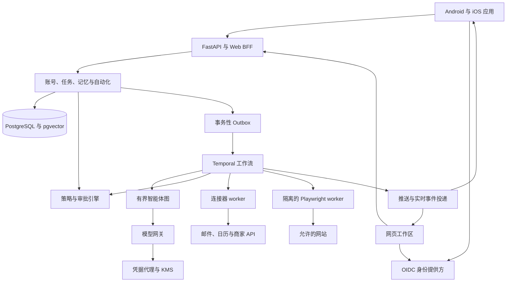
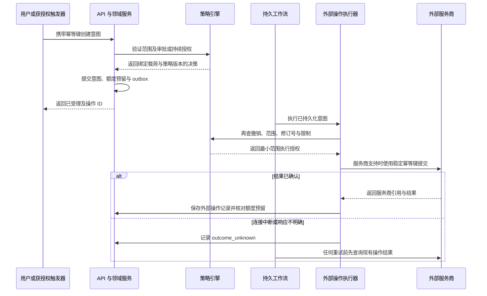
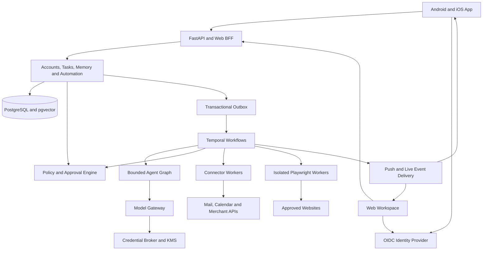
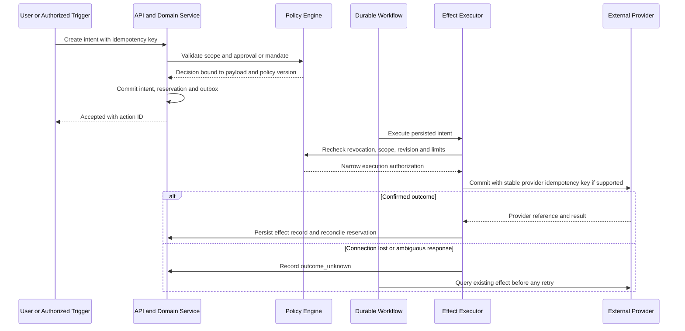

# Dayloom 产品架构

[简体中文](#dayloom-产品架构) | [English](#dayloom-product-architecture)

状态：本文描述目标架构，相关实现仍在开发、尚未发布。已发布的 v0.1 仍是单用户原型。
下一节记录实际源码实现；后续目标章节不代表功能已经交付。

## 未发布实现状态

| 领域 | 已实现源码 | 剩余发布门槛或范围 |
| --- | --- | --- |
| 身份与数据 | OIDC Code/PKCE、原生 PKCE 交接、哈希化且可轮换和撤销的会话、工作区范围 ORM、Alembic、强制 PostgreSQL RLS 与运行角色检查 | 真实 PostgreSQL/Keycloak 部署、后通道登出、完整账号删除、安全审查 |
| 模型配置 | 按工作区加密的 BYOK、允许的 HTTPS 来源、请求配额、输出 token 上限、明确的未配置状态 | 真实服务商验证、金额核算、流式输出、KMS |
| Agent 闭环 | 持久化目标和步骤、单工具决策、结果回流、明确审批、只读预授权、步数/有效期、暂停/继续/停止、工作成果与下载 | 真实模型与公网检索验收、并发负载、完整平台用例；不是 Temporal/LangGraph |
| MCP 设备 | 官方 SDK、精确地址允许列表、加密令牌、显式发现与工具选择、版本/参数校验、逐项审批；第一方回环服务支持能力查看、允许网站与校验下载 | 真实 Windows/macOS/手机测试、通用 App 控制、商家与支付集成、实际安装；第三方 MCP 不自动获得沙箱 |
| 邮件与自动化 | TLS SMTP、精确内容审批、有次数和到期限制的计划、暂停、持久化副作用开始标记、未知结果不重放及所有者报告结果 | 服务商 OAuth、投递验证、动态授权、通用补偿 |
| 浏览器 | 独立认证的执行器，只读取允许的公共 HTTPS 页面；全新沙箱 Chromium，禁用 JavaScript | 实际执行器和网络隔离验证；不支持已登录浏览、任意点击或结账 |
| 原生端 | Capacitor App/Browser 登录、Android Keystore 与 iOS Keychain 桥接、用户主动开启的 Android 本地通知采集、手动构建产物工作流 | 原生编译、真机测试、签名与分发、应用链接、推送、分享扩展、离线同步 |
| 商业交易 | 没有购买连接器 | 选择已授权商家、沙箱、支付授权、精确报价与预算规则、明确的购买审批 |

当前调度器仍基于数据库，不是 Temporal 或 LangGraph。账号模式的凭据库使用外部提供的 Fernet 密钥，
不是 KMS 信封加密。Android 桥接沿用现有 Java 工程，iOS 使用 Swift。
多数 HTTP 路由仍位于 `/api`，并未完整实现提议中的版本化 API。
默认模型现在是 `UnconfiguredProvider`；测试和有意运行的本地演示必须显式选择 `DemoProvider`。

本地验证和未验证环境记录在 [VERIFICATION.md](VERIFICATION.md)。实际配置、部署限制和原生构建前提见
[OPERATIONS.md](OPERATIONS.md) 与 [MOBILE.md](MOBILE.md)。这些内容不意味着已经发送真实邮件、完成购买或公开部署。

## 已发布的 v0.1

### 边界

React/Vite 客户端通过 HTTP 访问 FastAPI。工作区状态由 PostgreSQL 或 SQLite 保存。
独立 worker 执行已批准的本地工具。浏览器不负责作业、模型密钥或审批策略，只轮询当前状态。

v0.1 有意使用数据库作业，避免在尚无多步骤工作流时引入 Redis、Celery 和智能体图。
模型层是可替换适配器。未来 LangGraph 可以在相同操作边界后实现多步骤执行器；当前版本并未声称使用它。

模块：

- `backend/dayloom/api.py`：经过认证的 HTTP 边界与显式用户操作。
- `db.py`：类型化持久化与仅含元数据的审计记录。
- `policy.py`：确定性内容哈希与精确审批检查。
- `planning.py`：基于优先级、截止时间、容量和空闲区间的规则基线。
- `worker.py`：领取、租约、恢复与本地事务。
- `registry.py`：装饰器注册、模块发现与构造参数注入。
- `providers/`、`tools/`、`connectors/`：独立注册的实现。
- `apps/web`：客户端、浏览器测试和 Capacitor 配置。

### 操作生命周期

`pending -> queued -> running -> succeeded | failed`

用户审批会记录规范化工具名称和已验证载荷的 SHA-256 摘要。
编辑待审、排队中或失败的操作会清除审批并退回待审状态。失败操作必须重新进入审查后才能重试。
执行前可以取消；正在运行的数据库事务不会被中断。

worker 通过条件更新和租约领取作业，然后再次核验已批准的哈希。
当前工具与成功记录在同一事务提交。遗弃的租约可以回收，恢复尝试次数有上限。
初始版本每个 SQLite 数据库只支持一个 worker；需要扩展时使用 PostgreSQL。

不要在这些数据库事务中加入网络副作用。发送或发布工具需要持久化意图、服务商幂等键、
不确定结果核对，以及绑定精确收件人和正文的审批。浏览器智能体还需要隔离、凭据代理、资源预算和人工接管。

### 数据约定

任务状态表示用户工作的状态，操作状态表示 AI 执行的状态，两者属于不同对象。
不能仅因模型声称完成就将任务标为完成。记忆包含内容、来源、类别、版本和可选到期时间；
过期记忆不会进入模型上下文，用户编辑是最终依据。

数据库是权威数据源。JSON 导出是可移植快照，不是第二个实时数据库。
Markdown 导入导出和语义索引属于后续工作。删除记忆不等于删除全部来源证据：
除非清空整个工作区，否则聊天与操作历史仍然保留；备份有独立的保留周期。

### 首批验收门槛

| 范围 | 基线或检查 | 通过条件 |
| --- | --- | --- |
| 规划 | 同输入的截止时间与优先级规则基线 | 无事件重叠、容量超限或过去时间块 |
| 审批 | 修改载荷前后的对照 | 旧审批绝不执行已变更内容 |
| 恢复 | worker 租约过期 | 仅产生一次本地效果，并持久化结果 |
| 重试 | 失败后退回审查并重新批准 | 未重新批准不得重试 |
| 记忆 | 增删改查、到期与模型上下文捕获 | 活跃记忆上下文不含已删除或过期记录 |
| 日历 | 重复与畸形 ICS 导入 | 无重复；失败导入保留之前的快照 |
| 安全 | 令牌检查、恶意来源与预检 | 拒绝受保护的未授权请求；允许的原生预检正常 |
| 客户端 | 桌面与移动浏览器流程 | 增删改查、提案审批、执行结果可见且无横向溢出 |

后续模型实验必须先运行相同输入的规则基线，并定义对照矩阵。
不能根据不同数据、预算或评测器宣称模型规划更好；离线测试不认证远程模型质量。

### 原始后续计划

1. OAuth 只读连接器和显式来源撤销。
2. 跟进对象、事件触发、周期计划和通知预算。
3. 迁移工具、按用户的身份体系与稳健的离线冲突处理。
4. 原生安全存储、分享、日历和推送适配器。
5. 先建立副作用安全测试，再加入多步骤执行器和隔离浏览器执行。

## 目标产品

### 产品约定

交付可安装的 Android 与 iOS 客户端，背后使用真实账号系统、真实模型 API 和服务端执行。
移动客户端不是常驻智能体：关闭客户端后，计划工作仍由服务器继续处理。
设备权限与商店政策仍然适用，LLM 无法自行授予访问权限。

生产用户流程为：安装、登录、创建个人工作区、连接模型、授权集成、定义自动化规则、检查或批准操作。
模型未配置时应明确显示设置状态，而不是自动退回演示提供器。

### 架构决策

| 领域 | 决策 | 原因与边界 |
| --- | --- | --- |
| 移动界面 | 保留 React 与 Capacitor，增加 Swift/Kotlin 平台模块 | 复用客户端并交付签名原生包。界面仍由 WebView 渲染，不声称是完全原生界面。 |
| 原生能力 | 安全存储、应用链接、分享扩展、推送和 Android 通知监听 | 实现并测试平台行为，而非仅交付未经改动的网页外壳。 |
| Web | 保留响应式客户端供桌面访问和账号管理 | 共享产品逻辑与 API 类型；设备专属能力使用平台适配器。 |
| API | FastAPI 模块化单体、版本化 REST 和 SSE | 明确领域边界，不提前拆成大量微服务。 |
| 身份 | OIDC 提供方，初期使用 Keycloak；Authorization Code 与 PKCE | 不从零实现密码存储或 OAuth。更换身份提供方部署不改变领域归属。 |
| 状态 | PostgreSQL、SQLAlchemy 与 Alembic | 多用户约束、迁移、事务意图和行级纵深防御。SQLite 保留为本地客户端缓存或显式单用户兼容模式。 |
| 模型 | 内部模型网关，使用 LiteLLM 等持续维护的适配器 | 按工作区 BYOK、结构化输出、流式输出、配额和提供器专有能力；模型不获得执行权限。 |
| 智能体推理 | 工作流活动内有界的 LangGraph 图 | 规划和工具选择与授权、持久调度分开。 |
| 持久执行 | Temporal 工作流、计划、信号和活动 worker | 负责长任务、审批和恢复的生命周期；智能体图不维护第二套相互竞争的调度器或作业状态机。 |
| 检索 | PostgreSQL 加 pgvector | 将工作区过滤、来源溯源和删除控制放在权威数据附近。 |
| 临时状态 | Redis | 限流、短期协调与缓存；绝不作为审批或购买的唯一记录。 |
| 文件 | 兼容 S3 的私有对象存储 | 附件、收据和浏览器证据使用限定范围且会过期的访问 URL。 |
| 密钥 | KMS 信封加密；也可使用自托管密钥服务 | 加密用户凭据与模型上下文、应用日志分开存储。 |
| 外部执行 | 专用连接器 worker 和隔离的 Playwright 浏览器 worker | 网络副作用不在 API 数据库事务或原生界面进程中执行。 |
| 运维 | OpenTelemetry、脱敏结构化日志、指标与发布门槛 | 让失败、费用和操作结果可见，但不记录私人内容。 |

这些是逻辑组件，并不要求每张表对应一个独立服务。
初期将 API、工作流与连接器 worker、浏览器 worker 及必要基础设施部署为少量独立授权的进程组。



执行器必须在外部提交前立即重新检查同一授权策略。
模型提案、通知、工作流重试或收到的邮件都不是审批。
原生权限提示和财务确认不能被模型决定悄悄替代。

### 迁移原则

建设生产路径时，将当前原型保留为名称明确的开发模式。
不得把已有本地数据悄悄归入第一个注册的账号；管理员必须在备份和验证后，
显式将其迁入身份明确的个人工作区。

保留现有注册表模式：新增模型提供器、工具、连接器和工作流类型都使用独立模块、注册和经过验证的配置。
不要把当前 API 文件改成账号、提供器和平台分支的集合。

## 身份与数据隔离

Dayloom 登录、已连接邮箱账号、商家授权和模型 API 凭据是四种独立授权。
使用 Google 登录不等于允许读取 Gmail、发送邮件、花钱或使用模型服务商。

- 使用 OIDC Authorization Code、PKCE、state 和 nonce。原生登录打开系统认证浏览器，
	不使用会截获凭据的内嵌 WebView。服务端验证签发方、受众、签名、到期时间和会话有效性。
- 提供经过验证的邮箱登录，以及由身份提供方管理的通行密钥和 MFA。通过身份提供方接入 Google、Apple 联合登录。
	账号关联必须分别验证两个身份，不能只匹配未经验证的邮箱。
- 原生回调使用经过验证的应用链接或通用链接。短期访问令牌放在内存，轮换的刷新凭据放在 Keychain/Keystore 支持的存储中。
	Capacitor Preferences、localStorage 和 sessionStorage 不是生产凭据库。
- Web 会话通过 BFF 使用 Secure、HttpOnly Cookie，并有明确的 CSRF 保护与受限来源。
	不向网页脚本暴露刷新令牌。
- 用户初始拥有一个个人工作区。每个用户所属的数据行、对象、缓存项、向量、事件、工作流和浏览器会话都携带工作区身份。
	默认不开放与其他用户共享。
- 从经过验证的认证信息推导访问主体。请求中的工作区 ID 只是选择器，不能证明成员身份。
	每个资源都检查归属，包括导出、SSE 重放、附件和后台活动。
- 使用不能绕过 RLS 的非所有者应用角色，强制执行 PostgreSQL RLS。工作区上下文限定在事务内，并重置连接池中的连接。
	增加工作区复合外键和工作区范围唯一约束。RLS 是应用授权的补充，不是替代。
- 提供设备与会话列表、远程登出、刷新令牌撤销和账号删除。
	修改凭据、新增购买委托和高风险审批需要加强认证；本地生物识别解锁本身不能证明刚刚完成服务端授权。
- 运维人员默认只获得脱敏诊断，而不是不受限制的邮箱或记忆访问权限。
	任何例外支持访问都必须限时并记录审计。

## 模型网关与记忆

### 真实模型连接

应用提供模型连接界面：服务商、允许的端点、模型、密钥输入、能力测试、允许的数据类别和消费限制。
生产环境不得隐式使用 DemoProvider。演示数据只保留在明确标注的开发或测试配置中；凭据缺失或失败必须可见。

- 支持按工作区 BYOK。保存密钥引用、服务商、端点、模型标识、能力、同意版本和状态；提交后绝不返回原始 API 密钥。
	删除、撤销和轮换应是正式支持的操作。
- 使用由 KMS 封装的独立数据密钥加密凭据。解密角色与普通 API 读取权限分离。
	OAuth 刷新令牌、浏览器会话 Cookie 和模型密钥使用不同的凭据用途与访问控制列表。
- 初期支持已验证的 OpenAI 兼容提供器，再增加 Anthropic、Gemini 等适配器。
	能力检查覆盖工具调用、结构化输出、流式输出、视觉和嵌入兼容性；任意模型名称不意味着支持全部能力。
- 托管部署从允许的服务商来源开始。自定义兼容端点必须显式启用、使用 HTTPS，且出站策略覆盖 DNS、重定向、IPv4/IPv6、私网和云元数据地址。
	不要让可配置的基础 URL 变成 SSRF 代理；自托管私有模型端点需要管理员定义的网络例外。
- 每个凭据绑定对应服务商来源。端点变更会使凭据绑定和同意失效；不能向新的重定向目标转发认证头，也不能悄悄复用另一服务商的密钥。
- 网关负责模式验证、有界上下文组装、token 与并发限制、超时、核算和熔断。
	原子预留保守的请求最高费用，再按实际报告用量结算，区分估算与服务商账单。预算控制不可用时拒绝调用；切换服务商须事先获得同意。
- 通过经过认证的服务端事件流式返回响应。持久化请求和运行 ID、模型及版本、用量、延迟和错误类别；
	默认遥测排除原始密钥和私人提示词。服务商错误不能被伪装成成功。
- 模型调用和工具调用是不同能力。模型不能获取凭据、修改策略、自行批准操作或执行不受限制的 shell。
	不可信邮件、文档、通知和网页始终是数据，即使其中包含写给助手的指令。
- 模型 API 权限与计费独立于消费级聊天产品订阅。BYOK 也不使 Dayloom 自身的数字订阅豁免于适用的应用商店计费规则。

### 记忆与规划

明确区分三类存储：当前对话上下文、用户确认的长期记忆，以及带来源溯源的文档和事件。
模型可以建议保存记忆，但持久化必须来自显式保存或用户开启且范围明确的采集规则；不能悄悄把每条通知变成永久个人记忆。

检索先做工作区和权限过滤，再排序。结合关键词与向量检索，保留来源 ID、到期时间和敏感等级，并记录实际使用的来源。
更换嵌入提供器需要版本化索引并重新嵌入，不得混用不兼容向量。
导出、更正和删除覆盖来源记录、分块、索引、缓存和派生摘要，并说明备份保留政策；产品不能承诺删除外部服务商的数据。

沿用现有确定性规划器作为约束检查器与基线。LLM 可理解意图、估计子任务并解释选择，
但经过验证的约束仍负责日历可用时间、依赖和容量。
增加目标、任务依赖和跟进记录，包含等待条件、下次检查时间、提醒次数上限和免打扰时段。
日历连接器需要 OAuth 权限范围、webhook 续订、基于游标的同步和冲突规则；ICS 仍作为导入途径。

## 领域模型与 API

以下是拟议的领域聚合，并非 v0.1 已经存在的数据库表。

| 领域 | 主要记录 | 必须保持的约束 |
| --- | --- | --- |
| 身份 | 用户、外部身份、工作区、成员关系、设备、会话 | 没有当前有效的主体与工作区授权就不能访问 |
| 事务管理 | 目标、任务、依赖、跟进、日历账户与事件 | 任务完成与执行结果分别记录 |
| 智能 | 对话、消息、记忆、源文档、分块、模型连接 | 内容必须伴随来源、工作区访问控制、有效期与同意记录 |
| 自动化 | 自动化规则、触发事件、工作流运行、操作意图、操作修订 | 每个外部副作用都有唯一的持久逻辑意图和版本化载荷 |
| 授权 | 策略、自动化授权规则、审批、预算预留 | 禁止自我审批；在提交时检查限制与撤销状态 |
| 集成 | 连接、凭据引用、同步游标、Webhook 收件箱 | 服务商账户和权限范围绑定到一个获授权工作区 |
| 外部副作用 | 执行尝试、外部操作账本、邮件记录、订单、回执 | 超时不能证明外部操作没有发生 |
| 证据 | 审计事件、产物、导出与删除任务、用量账本、事务发件箱 | 审计元数据和排队任务必须在进程故障后保留 |

生产接口使用 `/api/v1` 版本前缀，从 OpenAPI 生成客户端类型，并兼容已发布的移动端版本。
拟议的路由分组如下：

| 路由分组 | 职责 |
| --- | --- |
| `/me`、`/devices`、`/sessions` | 身份、设备注册与会话管理 |
| `/workspaces/{workspace_id}/tasks`、`/memories`、`/calendar` | 带工作区范围的事务数据 |
| `/workspaces/{workspace_id}/model-connections` | 创建、测试、轮换和删除模型凭据；读取仅返回元数据 |
| `/workspaces/{workspace_id}/connections` | 发起 OAuth、绑定回调、权限范围、状态与撤销 |
| `/workspaces/{workspace_id}/runs`、`/actions`、`/approvals` | 规划、检查、修订、授权、取消及核对执行结果 |
| `/workspaces/{workspace_id}/automations`、`/mandates` | 触发器、计划与明确的持续授权 |
| `/workspaces/{workspace_id}/events` | 带身份验证、序列 ID 和有界重放的 SSE |
| `/workspaces/{workspace_id}/exports`、`/deletions` | 持久化且限定范围的数据生命周期操作 |
| `/webhooks/{provider}` | 经服务商验证并映射到已注册连接的入站请求 |

同一示例行中省略前缀的工作区路由共用 `/workspaces/{workspace_id}`。
使用游标分页、UTC 时间点与明确的 IANA 时区、乐观版本控制、结构化错误码和稳定的事件模式。
客户端命令携带按主体、端点和载荷哈希限定范围的幂等键；同一个键搭配不同载荷时必须拒绝。
审批请求还包含操作修订号、摘要、有效期和防重放随机数。GET 接口不得改变状态。

## 持久执行与授权

### 单一持久控制流

在同一个 PostgreSQL 事务中保存领域变更和 outbox 事件。转发器以确定的工作流 ID 和幂等事件 ID
启动 Temporal 工作流或向其发送信号。事件可能重复投递。Temporal 负责计时器和工作流进度，
PostgreSQL 负责领域数据、授权和外部操作账本。界面上的运行状态是带版本的投影，不是独立执行器。

LLM 调用和外部 I/O 只在工作流 activity 中运行，不放在要求确定性的工作流代码中。
有界智能体图必须设置步骤、时间和 token 预算，不能另建一套竞争的调度器。
工作流历史只保存引用和最少元数据，不保存明文密钥或完整邮箱；敏感载荷需要加密与保留期控制。
升级使用工作流版本管理，周期性自动化使用有界历史和 continue-as-new。

工具注册须声明模式、所需权限、风险等级、允许的目标、幂等策略、结果核对、可选补偿及限制。
一次审批授予的是特定能力，不是任意未来调用权限。凭据代理在向相应执行器释放最小范围凭据前，
必须再次检查该能力。入站 Webhook 使用各服务商规定的签名或令牌验证、重放检查和持久去重。

### 授权模式

| 模式 | 允许的行为 | 必需的控制 |
| --- | --- | --- |
| 观察 | 只读取明确连接的数据源 | 来源权限、数据最小化、模型共享同意与配额 |
| 建议 | 准备计划、本地草稿和待审批操作 | 不修改远端数据，不隐式发布 |
| 逐项确认 | 执行与审批完全一致的操作 | 绑定载荷与修订号、有效期、重新检查策略，必要时加强身份验证 |
| 有界自动化 | 在用户编写的授权规则内执行，无需逐次询问 | 明确目标、载荷约束、有限额度、有效期、撤销与回执 |

持续授权规则须规定连接、允许的工具及版本、触发器、收件人或商户/SKU、内容或模板约束、数据源、
单次与累计额度、频率、时区、有效期和升级处理规则。修改规则需要用户权限。
导入内容不能创建或扩大授权规则，也不存在不受限制的“全部允许”模式。

例如，用户可以授权使用指定模板和选定的任务字段，每周向一个已验证地址发送摘要。
新增无关收件人、附件或数据源需要重新审批。自动购买还需要限定商品与支出的商户/支付授权，
不能沿用普通邮件或浏览器权限。先实现逐项确认，连接器通过恢复和策略测试后再启用有界自动化。

### 外部操作生命周期

```text
proposed -> awaiting_approval -> authorized -> queued -> executing
executing -> succeeded | failed | outcome_unknown
outcome_unknown -> reconciling -> succeeded | failed | manual_review
```

匹配且有效的持续授权规则可以代替逐项确认，但仍须保存策略决策和规则版本。
外部提交前的撤销或过期必须阻止执行。确认在提交前取消的操作进入 `cancelled`；
提交开始后的取消只是请求停止后续步骤，不能承诺撤回邮件或订单。
补偿是另一个需要授权的操作，本身也可能失败。



网络调用期间不要保持数据库事务开启。先原子领取任务并预留额度，再调用服务商并持久化结果。
仅靠内部唯一约束无法保证外部操作恰好一次。必须遵守服务商幂等键的保留期和语义；
超时后换一个新键可能造成重复扣款。结果不明的非幂等调用不得盲目自动重试。
失效 worker 与并发尝试不能各自提交同一意图。服务商无法确认结果时，停止并转入人工核查。

## 外部能力

### 邮件自动化

Gmail 和 Microsoft Graph 分别实现为注册式连接器，初期使用用户本人邮箱的委托授权。
发送权限与收件箱读取/同步权限分别申请。Gmail 的 `gmail.send` 属于敏感权限；
读取、管理草稿或广泛修改可能需要受限权限及额外验证或安全评估。
不能仅为了发送本地准备的邮件而申请完整邮箱访问权。

使用结构化收件人和 MIME 库。发送意图绑定发件账户、To/CC/BCC、主题、正文、附件哈希和计划发送时间。
HTML 预览须净化，不自动加载远程邮件追踪资源。定时发送由服务器负责，App 可以关闭。
已启用的持续授权可以允许周期发送，但必须限制收件人、内容来源和发送频率。

先创建意图，再发送，并保存稳定的消息/关联 ID。区分 `accepted_by_provider`、`sent` 和
`delivery_confirmed` 的证据：Graph 的 202 响应仅表示受理，不能证明处理完成或送达。
邮箱 API 通常无法证明邮件进入收件箱或被收件人阅读。只有另行获得所需读取权限后，
才能利用服务商引用或已发送文件夹证据核对不确定的发送结果。
如果只有发送权限且没有安全核对机制，未解决的发送必须转入人工核查。
重复使用 Message-ID 或数据库锁都不能证明远端会去重。

加入配额、重复收件人限制、防循环、退信/错误处理和即时停止开关。
本个人助手不包含未经请求的批量邮件功能。断开连接须停止新发送，并使排队任务的授权失效。

### 购买自动化

通过逐个批准的商户集成支持购买。首先选定具备获授权下单 API、适当客户授权和测试环境的商户。
Stripe 集成不是从任意零售商购买商品的通用 API，购物车 API 也不一定是支付 API。

购买契约包含商户账户、准确的 SKU/款式、数量、币种、商品价格、税费、运费、总额上限、
地址引用、支付方式引用、报价有效期和替代商品策略。金额按币种及最小货币单位的整数存储，
不能使用浮点数。在事务中同时预留单笔订单额度和持续授权的累计预算，
防止并发订单分别消费同一份剩余额度。

只有商户与支付服务商支持，且用户明确授权后，才能进行有界自动补货。
商品、卖家、地址、币种、费用变化或报价过期都需要重新验证；超出授权范围时须重新审批。
新购买或例外购买使用逐项确认和加强身份验证。不得绕过服务商要求的验证挑战、
3-D Secure、钱包确认和法律检查。

使用商户保存的支付引用或托管支付信息收集页面；Dayloom 不保存卡号/CVV，也不把支付凭据放入提示词。
保存订单和支付引用、回执、待处理/已确认/已退款状态及支持链接。退款或取消失败必须保持可见。
仅在确认失败或取消后释放预算预留，不能因网络超时就释放。
没有支付或商户写入权限时，只能提供辅助结账/交接，不能宣称自动购买。
按商店分别评估数字商品计费规则；实物购买和 Dayloom 订阅是不同的支付流程。

### 通知采集

| 平台 | 支持的设计 | 明确限制 |
| --- | --- | --- |
| Android | 原生 Kotlin NotificationListenerService、明确的系统通知访问授权和逐应用允许名单 | 不是完整历史收件箱；工作资料、OEM 行为、停止的应用及系统脱敏会影响可见内容 |
| iOS | Dayloom 自身的推送/本地通知、分享扩展、快捷指令及获授权的数据源 API | 没有收集其他应用通知的通用公开 API；通知服务扩展只处理本应用通知 |
| 桌面 | 未来单独审查、具有各操作系统授权的配套客户端 | 不能假定移动端权限也适用于 Windows/macOS/Linux，进而宣称已支持 |

接收 Dayloom 推送与读取 Android 通知是不同权限。所有来源应用默认关闭。
请求系统授权前说明采集以及云端/模型共享；提供暂停、逐应用选择、预览、删除和立即响应权限撤销的能力。
不能使用无障碍或特权访问来绕过通知限制。

任何上传前先在设备端过滤和脱敏。不采集一次性验证码、密码或其他身份验证秘密；
Android 自身的验证码脱敏必须继续有效。原始通知默认保留在本地。
拟议的初始保留策略为加密本地采集 24 小时、明确启用的云端内容最多七天；
发布前须由负责人审核这些默认值。写入长期记忆需要单独保存或范围明确的规则。

按设备、来源和事件身份对通知更新去重。同步数据包含采集时间、来源、权限状态和单调递增序号。
明确展示采集缺口，不能承诺恢复从未观察到的通知。遵守移除/锁定信号并清理受保护的缓存内容。
该能力不授予短信数据库、微信历史或其他应用文件的访问权。
手机关机会停止设备采集，即使服务器任务仍可继续。

### 浏览器执行

每次运行/每个工作区使用独立的 Playwright 沙箱执行环境。
常规 API 主机和用户现有浏览器配置不是沙箱。使用非 root worker、Chromium 沙箱、加固运行时、
无宿主机挂载、隔离且加密的配置、资源限制以及默认拒绝的出站代理。
仅有浏览器 context 不是不可信租户之间的安全边界。

只允许已批准目标。对子资源、DNS、重定向、下载、WebSocket 及内部/元数据地址同样实施限制，
不能只检查初始 URL。下载文件须隔离，不得执行。会话、Cookie 和远程控制端点按工作区隔离、
设置有效期，且绝不向模型暴露。用户进行身份验证时暂停自动化和敏感内容录制。

展示进度、当前目标、脱敏证据、停止和人工接管入口。初期使用单独认证的 Web 接管控制台；
移动端远程交互需要另行评估商店政策。验证码、MFA、支付确认或不明确的网站状态，
均交由合法用户接管。

模型可以提出导航、提取或填写受支持表单的建议。修改状态的步骤必须通过已审查的网站适配器，
向策略系统描述准确的外部操作。任意按钮文案、HTTP 方法或 LLM 判断都不是可靠的读写边界。
不受支持的网站仅提供辅助能力，不能承诺在所有网站上安全无人值守结账。
页面内容不能扩大工具或网络权限。受支持网站的契约变化时，停止或重新规划。

App 必须具备有用的原生/产品功能，不能只是网站包装或通用云远程桌面。
将浏览器接管放入 iOS 客户端前，审查 Apple 关于最低功能、远程客户端、第三方访问和支付的规则。
第三方条款和 API 使用权是连接器上线前必须通过的门槛。

## 移动体验与分发

### 产品界面

保留现有任务、记忆和时间线概念，同时加入真正的移动应用生命周期，并清楚区分个人事务与自动化。

| 界面 | 必需的行为 |
| --- | --- |
| 首次引导 | 登录、选择部署/工作区、配置真实模型并选择数据共享权限；不预选任何集成 |
| 今日与任务 | 适合原生设备的导航、计划、截止时间、依赖、跟进状态与快捷记录 |
| 助手 | 流式对话、来源引用、所选模型、实时运行状态与取消控件 |
| 自动化 | 触发器、范围、收件人/商品、计划、预算、有效期、试运行预览、启用/暂停与紧急停止 |
| 审批 | 准确的收件人/正文或订单报价、变更字段高亮、有效期、加强身份验证与拒绝 |
| 活动 | 已受理/已发送/已确认/结果不明等状态、尝试记录、回执、证据与恢复/交接 |
| 记忆与来源 | 查看、纠正、到期、删除和导出；展示来源与共享目标 |
| 设置 | 账户/设备、模型连接、已连接服务、通知权限、用量、保留期及账户删除 |

通过真正的本地化层提供简体中文和英语，包括错误与同意文案，不能复制两套硬编码页面。
遵循区域日期、IANA 时区、币种和无障碍设置。在设备上测试键盘避让、安全区域、读屏、动态文字、
触控目标、深层链接、回到前台后的状态恢复和权限拒绝状态。
平台不支持的能力应明确不可用，不能展示没有实际作用的控件。

### 原生模块与离线行为

为安全存储、身份验证回调、推送、分享、日历和通知采集引入带类型的平台接口。
使用持续维护的原生库及经过审查的 Capacitor 桥接；Android 监听器使用 Kotlin，iOS 扩展使用 Swift。
具有原生权限的 WebView 只加载随应用打包的内容，不可信网页在外部或隔离浏览器服务中打开。
绝不能向模型生成的 HTML 或任意远程内容暴露原生桥接。

使用加密、按账户隔离的本地缓存和客户端命令 outbox。缓存任务、草稿和选定视图以支持离线读取/编辑，
再通过幂等命令 ID 和版本检查同步。冲突必须可见，不能静默覆盖更新的数据。
审批、外部发送和购买必须在线验证策略。界面状态须区分待同步、排队、等待授权、运行中与结果不明。
退出登录或撤销访问时清除本地秘密和私有缓存。

前台使用 SSE，后台使用 APNs/FCM 发送最少信息的提示。推送只携带不透明的操作/运行引用，
不携带私信正文或支付凭据。拒绝通知权限不能阻断其他功能。
推送只是重新同步的提示，不是权威操作结果，且不能保证送达。周期计划由服务器负责。
Android WorkManager/iOS 后台任务仅进行系统允许的同步，不是无限制常驻手机智能体。
部署面向无法使用 FCM 的用户时，在完成 SDK/隐私审查后采用当地可用的推送服务。

### 可下载产物

- Android：生成可复现的签名 release APK 用于受控下载，并生成 AAB 用于 Play 分发。
	负责人掌握发布密钥库、身份、备份及更新签名连续性。debug APK 不是生产发布包。
- iOS：在 macOS/Xcode runner 上构建和归档，通过 TestFlight、App Store 或明确符合资格的其他渠道分发。
	IPA 不是像 APK 一样可普遍安装的下载文件。开发者注册、配置描述文件、entitlement 和审核仍是前置条件。
- 开发、预发布和生产环境分别使用应用 ID、API 端点、OAuth 客户端、推送凭据与签名。
	发布构建连接已部署的 HTTPS API，而不是开发者的 localhost，且不包含服务器/模型/OAuth 客户端秘密。
- 发布版本化产物元数据、校验和、发布说明、支持的系统版本与后端兼容性。
	私有测试下载保留访问控制；开放公共分发渠道需要负责人另行决定。
- 原生功能变更须经过签名构建及要求的商店流程，不能用远程代码或功能开关隐藏未经审核的能力。
- 商店就绪要求包括有用的设备集成、准确截图、隐私/数据安全声明、应用内账户删除、AI 共享同意、
	支持联系方式和适用的登录/支付规则。Capacitor 生成了 Android/iOS 项目并不保证审核通过。

选择 Capacitor 是复用与交付决策，不要求未来所有界面永远通过 Web 渲染。
后续迁移 React Native 或原生页面可以复用 API 和领域契约。
除非设备可用性/性能测试或明确的原生 UI 要求能够证明必要性，现在不要维护第二套完整界面。

## 代码与部署边界

### 拟议代码组织

以下路径描述迁移目标，尚未全部实现。

```text
apps/web/
	src/features/                  账户、助手、事务与自动化视图
	src/platform/                  带类型的原生/Web 能力适配器
	android/                       Android 客户端、Kotlin 模块和原生测试
	ios/                           iOS 客户端、Swift 扩展和原生测试
packages/
	api-client/                    生成的 OpenAPI 类型与客户端传输层
	native-bridge/                 共享原生能力契约
backend/
	dayloom/
		api.py                       精简的应用/启动组合
		http/                        版本化路由与认证依赖
		domains/                     账户、事务、记忆、操作与自动化
		policy/                      审批、持续授权与预算决策
		providers/                   注册式模型适配器
		connectors/                  注册式外部账户集成
		tools/                       注册式、带类型的外部操作契约
		workflows/                   注册式持久工作流定义
		execution/                   凭据代理、重试与结果核对
		infrastructure/              持久化、outbox、存储与遥测
	migrations/                    经过审查的 Alembic 修订
	tests/                         领域、策略、隔离与集成测试
deploy/                          按环境划分的服务清单
```

逐步将现有处理函数提取到领域服务之后。新增插件应是注册模块、经过验证的配置和测试，
而不是在 API 启动代码里增加分支。模式或公共契约变更仍需要明确的迁移与审查。
用户不能向托管 worker 上传任意可执行插件。未来 MCP 集成必须遵守与第一方连接器相同的
凭据、模式、目标和策略边界。

### 部署拓扑

从单一区域开始，区分开发、预发布和生产环境。API 与非浏览器 worker 可以共用部署单元，
但保留不同服务身份。浏览器 worker 在主机/运行时和网络层隔离。
PostgreSQL、Redis、Temporal 和身份提供方属于私有服务；应用、身份与工作流基础设施
使用各自的数据库/角色。仅暴露 TLS 网关和明确需要的回调端点。

本地 Compose 用于开发，不自动代表达到生产就绪状态。
受支持的托管测试版，在预算允许时优先使用托管 PostgreSQL/备份和工作流基础设施；
自托管配置沿用相同契约，并记录升级与备份流程。
只有隔离、调度或规模需求足以抵偿运维成本时才引入 Kubernetes。
不要一开始就为每个领域建微服务，再加入 Kafka 和独立向量数据库。

使用事务 outbox 与 Webhook inbox，避免引入职责冲突的多套队列。
按各服务商规范签名/验证回调，绑定连接 ID 并按事件 ID 去重。
服务商缺少可靠 Webhook 时使用定期同步/结果核对，不能假定所有服务商采用同一种 HMAC 方案。
会话密钥、KMS 访问和加密材料须能跨部署保留，但不能嵌入容器镜像。

### 运维与隐私

- 在 API、工作流和外部操作之间传递追踪 ID；监控队列等待时间、过期审批、结果不明的操作、
	连接器撤销、服务商限流、模型支出和浏览器资源用量。基础设施健康、模型质量和外部服务可用性分别监控。
- 初始指标是待测试的发布标准，不是已达成数据：测试版核心 API 月可用性 99.5%；
	在约定负载下，排除模型调用的普通 CRUD p95 小于 500 ms；托管生产数据 RPO 不超过 15 分钟、
	RTO 不超过四小时。对外承诺前先验证容量与恢复流程。
- 使用加密备份与时间点恢复。恢复演练须一致地恢复授权、凭据、工作流和外部操作记录。
	恢复后暂停外部写入，直到核对确认已经发出的操作；重放旧数据库不能导致重复发信或重复购买。
- 为权限变更和外部操作保留只追加审计记录，必要时提供可检测篡改的导出。
	审计内容中的个人信息最小化；订单或法律义务所需的保留例外须明确说明，不能隐藏。
- 账户删除须撤销授权、阻止新任务、处理运行中/结果不明的操作，并通过持久删除任务移除
	应用内容、向量、缓存和产物。说明备份过期时间以及独立第三方的保留行为。
- 默认不使用用户内容训练模型。AI 共享需要用户明确同意目标和数据类别。
	将已连接账户数据传给选定模型前，审查服务商保留政策以及 Google 等平台的数据使用限制。
- 包含限流、滥用举报、依赖与秘密扫描、SBOM/许可证审查、补丁、事件响应、用户通知和经过测试的紧急停止。
	安全事件发生时冻结受影响的执行权限，不能只是关闭界面。
- 分别跟踪模型 token、嵌入、浏览器 CPU 时间、存储、流量和托管基础设施成本。
	BYOK 不代表服务器和浏览器基础设施免费。预算面板须展示估算与结算用量的区别。

## 交付计划与验收

### 里程碑

按纵向功能交付，每阶段都包含可工作的客户端和后端。外部操作在通过对应门槛前保持关闭。
不能把模拟服务商、生成的项目目录或 lint 通过描述为功能完成。

| 阶段 | 交付物 | 完成门槛 |
| --- | --- | --- |
| P0：基础 | 账户登录、数据隔离、迁移、秘密存储、生产配置及已部署的预发布 API | 两个真实测试账户不能访问彼此的记录、流、产物或凭据；备份/导入/回滚检查通过；生产环境无法访问旧全局路由 |
| P1：可安装的真实助手 | 已签名 Android 内部 APK、iOS 构建/TestFlight 路径、真实模型设置/流式响应、任务、记忆及获批准的本地操作 | 全新设备可安装、登录、配置真实服务商、完成真实模型辅助任务并在重启后恢复状态；模型错误不切换到演示模式 |
| P2：可靠自动化 | Temporal 计划、跟进、持续授权、实时事件、推送及暂停/撤销控件 | worker 故障、重复事件、离线客户端和审批过期不能绕过授权或丢失逻辑意图 |
| P3：邮件与日历 | Gmail/Graph OAuth、真实发送、有界定时邮件及增量日历同步 | 明确授权的测试邮箱发送有可验证的服务商证据；权限撤销阻断排队任务；不确定发送不重复；日历游标/重复事件/夏令时测试通过 |
| P4：设备与浏览器 | Android 指定应用通知采集、iOS 分享、隔离 Playwright 任务与接管 | 真机权限/撤销及隐私测试通过；恶意页面不能访问凭据/内部网络或执行未经批准的操作 |
| P5：交易 | 一个获批准商户的报价/审批/下单/回执流程，再加入有界补货 | 商户沙箱验证预算竞争、价格变化、重复回调、超时、取消/退款及不明结果恢复；真实购买冒烟测试需要用户单独且准确的授权 |
| P6：发布加固 | 签名发布、隐私/商店提交、运维手册与支持 | 原生设备矩阵、安全审查、恢复演练、负载/成本测试、无障碍和删除门槛通过；无未解决的发布阻断风险 |

P1 是第一个有实际用途的可下载版本，不承诺 P3-P6 已经具备。
P0-P2 契约稳定后，邮件、通知和浏览器工作可分别安排人员；它们共用执行与策略控制。
商户选择、服务商和商店批准可能位于关键路径。人员、发布账户和服务商访问确认前，
不能给出可信的固定完成日期。预算须覆盖移动/原生、后端/工作流、集成、QA/自动化及安全/运维职责，
即使由同一人承担多个角色。

### 测试矩阵

| 风险 | 必需的检查 |
| --- | --- |
| 账户隔离 | 两个用户、猜测 ID、导出、SSE 重放、向量、对象、后台任务和缓存键；使用真实应用角色测试 RLS |
| 授权 | 载荷变化、旧审批、过期/撤销的持续授权、错误连接、审批重放，以及提议至提交之间的策略变化 |
| 外部重复执行 | 请求前、请求中、服务商成功后但本地落盘前的故障；重复 worker/Webhook；服务商幂等有效期届满 |
| 支出 | 并发预留、费用/币种变化、待处理支付、报价过期、退款失败与预算耗尽 |
| 模型行为 | 无效 JSON、不支持的工具、限流、长上下文、服务商故障、非预期模型能力与成本超限 |
| 提示注入 | 恶意邮件/文档/通知/网页要求泄露秘密、改变收件人、增加权限或执行任意代码 |
| 移动端 | 全新安装、升级、账户切换、安全存储、离线冲突、权限撤销、强制停止、重启、推送过期与深层链接认证 |
| 浏览器隔离 | 跨会话存储、SSRF/DNS 重绑定、重定向、文件下载、沙箱逃逸暴露面、接管过期与敏感内容录制 |
| 数据生命周期 | 来源/记忆删除传播到派生索引、用户导出、凭据轮换及恢复后的外部结果核对 |
| 分发 | 发布签名连续性、API/版本兼容、实际设备安装、当前商店 SDK/适用的 16 KB 兼容性及必需隐私元数据 |

先使用可控服务商替身进行确定性故障注入，再使用服务商沙箱/测试账户，最后进行窄范围明确授权的真实冒烟测试。
浏览器视口测试不能替代原生测试，模拟邮件/订单测试不能替代真实连接器授权和证据。
本工作区的 Chromium 下载限制仍是本地验证约束；应使用获批准的 CI/浏览器运行环境，不能绕过该政策。

评估新的模型/智能体方法前，定义输入匹配的 baseline、数据集/split、服务商/模型版本、提示词、工具、
token/时间预算和评测器。在相同样例上比较确定性/模板 baseline、单步结构化模型 baseline 与多步智能体，
并对随机行为重复运行。报告成功率、错误操作、审批违规、重复执行、延迟、成本与不确定性。
安全约束必须独立通过，不能用平均任务成功率提升抵消违规。

### 渐进迁移

1. 备份 v0.1，并通过版本化 Alembic baseline 冻结其模式。将旧本地配置与生产启动分开，
	在生产环境禁用匿名/全局令牌访问。
2. 引入身份/工作区，明确分配导入数据、回填归属，再实施非空/复合约束、服务授权和 RLS。
	部分数据尚未完成隔离时，不能开放多用户访问。
3. 将全局模型秘密替换为加密的工作区模型连接。客户端从 sessionStorage 访问令牌迁移到
	选定的原生/Web 会话契约及生成的 API 类型。
4. 引入操作修订、持续授权、外部操作账本和 outbox。通过版本化工作流契约将新执行迁入 Temporal。
	排空或明确迁移旧任务；旧、新 worker 绝不能同时拥有同一个任务。
5. 外部连接器逐个接入，能力默认关闭，每个都具备自己的沙箱与故障测试。
	保留确定性规划器作为对照 baseline 和约束检查器。
6. 先针对预发布环境发布签名原生测试包。使用 expand/contract 数据库变更和工作流版本管理，
	避免已安装的旧客户端迫使系统破坏性回滚或重放外部操作。

### 实施前的负责人决策

默认建议先推出 Android 私有测试版，使用同一核心 API，并在平台允许的范围内规划 iOS 对等能力。
承诺支出、开通服务或公布发布日期前，须确认：

- 发布受众和地区；仅支持自托管，还是运营托管服务。
- 发布者身份、稳定应用 ID、Android 签名归属，以及 Apple 开发者注册/macOS runner 访问。
  如果要求完全原生 UI，须独立于可安装混合应用打包做决策，它会改变客户端工作量估算。
- 首个模型服务商与预算、允许的数据共享目标，以及托管服务是否需要用户自定义模型端点。
- 首个邮件/日历服务商、OAuth 应用归属及验证路径。
- 一个具有真实下单/支付授权的初始商户；缺少该条件时，只提供辅助结账，不承诺通用购买。
- 托管地区、数据保留和恢复目标、支持责任及可接受的预授权自动化范围。
  不要通过聊天提交这些决策涉及的密码、密钥或令牌。

## 官方参考资料

本方案于 2026-10-30 审阅以下资料。这些引用用于确立平台和服务商约束，
不代表 Dayloom 已通过其审核。实施和发布前须重新核对适用规则与权限范围。

- [Android NotificationListenerService](https://developer.android.com/reference/android/service/notification/NotificationListenerService)：用户授权、生命周期及工作资料限制。
- [Android 15 验证码脱敏](https://developer.android.com/about/versions/15/behavior-changes-all#otp-redaction)：敏感通知保护。
- [Apple User Notifications](https://developer.apple.com/documentation/usernotifications)：应用自身通知的投递和处理，不是通用跨应用收件箱。
- [Apple App 审核指南](https://developer.apple.com/app-store/review/guidelines/)：支付、最低功能、远程客户端、登录、账户删除，以及明确的第三方 AI 数据共享同意。
- [Gmail 发送指南](https://developers.google.com/workspace/gmail/api/guides/sending)：支持的发送/草稿 API 与 MIME 处理。
- [Gmail 权限分类](https://developers.google.com/workspace/gmail/api/auth/scopes)：敏感与受限权限的区别，以及验证/评估要求。
- [Microsoft Graph sendMail](https://learn.microsoft.com/en-us/graph/api/user-sendmail?view=graph-rest-1.0)：委托 Mail.Send 权限及 202 Accepted 的局限。
- [Stripe 幂等请求](https://docs.stripe.com/api/idempotent_requests)：服务商特定的重试语义与保留期，不代表对所有商户都有购买权限。

---

# Dayloom Product Architecture

Status: target architecture with an unreleased implementation in progress. The
shipped v0.1 is still a single-user prototype. The next section records actual
source implementation; the target sections below are not a claim of delivery.

## Unreleased Implementation Status

| Area | Implemented source | Remaining release gate or scope |
| --- | --- | --- |
| Identity and data | OIDC Code/PKCE, native PKCE handoff, hashed/rotating/revocable sessions, workspace-scoped ORM, Alembic, forced PostgreSQL RLS and runtime-role checks | Real PostgreSQL/Keycloak deployment, backchannel logout, full account deletion, security review |
| Model configuration | Per-workspace encrypted BYOK, approved HTTPS origins, request quotas, output-token bounds, visible unconfigured state | Live provider validation, monetary accounting, streaming, KMS |
| Agent loop | Persisted goals/steps, one-tool decisions, result feedback, explicit approvals, read-only preauthorization, step/expiry limits, pause/resume/stop, artifacts/downloads | Live model/search acceptance, concurrent load and complete platform workflows; not Temporal/LangGraph |
| MCP devices | Official SDK, exact endpoint allowlist, encrypted tokens, explicit discovery/selection, version/schema checks, per-call approval; first-party loopback inspection, approved websites and checked downloads | Real Windows/macOS/phone testing, general app control, merchant/payment integration and installation; no implicit sandbox for third-party MCP |
| Mail and automation | TLS SMTP, exact-content approval, finite expiring schedules, pause, durable effect-start marker, unknown-outcome no-replay and owner-reported resolution | Provider OAuth, delivery verification, dynamic mandates, generalized compensation |
| Browser | Separate authenticated runner for approved public HTTPS page reads, fresh sandboxed Chromium, JavaScript disabled | Actual runner/network isolation verification; no authenticated browsing, arbitrary clicks or checkout |
| Native | Capacitor App/Browser login, Android Keystore and iOS Keychain bridges, opt-in local Android notification capture, manual artifact workflow | Native compilation, device tests, signing/distribution, app links, push, share extensions, offline sync |
| Commerce | No purchase connector | Authorized merchant selection, sandbox, payment grants, exact quote/budget rules and explicit purchase approval |

The current scheduler remains database-backed, not Temporal or LangGraph. The
credential vault uses an externally supplied Fernet key in account mode, not KMS
envelope encryption. Android bridge source follows the existing Java project;
iOS uses Swift. Most HTTP routes remain under `/api`, not the complete proposed
versioned API. Default model selection is now `UnconfiguredProvider`; tests and
intentional local demos select `DemoProvider` explicitly.

Local verification and unverified environments are recorded in
[VERIFICATION.md](VERIFICATION.md). Actual configuration, deployment limits and
native artifact prerequisites are in [OPERATIONS.md](OPERATIONS.md) and
[MOBILE.md](MOBILE.md). No live email, purchase or public deployment is implied.

## Shipped v0.1

### Boundaries

The React/Vite client speaks HTTP to FastAPI. PostgreSQL or SQLite owns the
workspace state. An independent worker executes approved local tools. The browser
does not own jobs, model keys or approval policy. It polls for current state.

The v0.1 runtime deliberately uses database-backed jobs instead of adding Redis,
Celery and an agent graph before there are multi-step workflows. The model layer
is a replaceable adapter. LangGraph can later implement a multi-step runner behind
the same action boundary; the current version does not claim to use it.

Modules:

- `backend/dayloom/api.py`: authenticated HTTP boundary and explicit user actions.
- `db.py`: typed persistence and metadata-only audit records.
- `policy.py`: deterministic content hash and exact approval check.
- `planning.py`: rule baseline for priority, deadlines, capacity and free intervals.
- `worker.py`: claims, leases, recovery and local transactions.
- `registry.py`: decorator registration, module discovery and constructor injection.
- `providers/`, `tools/`, `connectors/`: independently registered implementations.
- `apps/web`: client, browser tests and Capacitor configuration.

### Action lifecycle

`pending -> queued -> running -> succeeded | failed`

User approval records a SHA-256 digest of canonical tool name and validated
payload. Editing a pending/queued/failed action clears approval and returns it to
pending. A failed action can be retried only after returning to review. Cancellation
is supported before execution; running database transactions are not interrupted.

The worker claims jobs with a conditional update and a lease, then verifies the
approved hash again. Current tools and success records commit in one transaction.
An abandoned lease can be reclaimed; recovery attempts are bounded. The initial
release supports one worker per SQLite database. PostgreSQL is the scale-up path.

Do not add network side effects inside these database transactions. A sending or
publishing tool needs durable intent, provider idempotency keys, uncertain-outcome
reconciliation and approval bound to the exact recipient and body. A browser agent
also needs isolation, credential brokering, resource budgets and human takeover.

### Data contracts

Task status is user-work status; action status is AI-execution status. They are
different objects. A task is never marked done just because a model said so.
Memory has content, source, category, version and optional expiry. Expired memory
is excluded from model context. User edits are the source of truth.

The database is authoritative. JSON exports are portable snapshots, not a second
live database. Markdown import/export and semantic indexing are follow-ups.
Deleting a memory is not deleting all source evidence: chats and action history
remain unless the entire workspace is erased. Backups have independent retention.

### First acceptance gates

| Slice | Baseline/check | Pass condition |
| --- | --- | --- |
| Planning | Deadline/priority rule baseline, identical input | No event overlap or capacity overflow; no past blocks |
| Approval | Before/after payload mutation | Old approval never executes changed content |
| Recovery | Expired worker lease | One local effect and a persisted result |
| Retry | Failure to review to fresh approval | No retry without renewed approval |
| Memory | CRUD, expiry and model-context capture | Deleted/expired record absent from active memory context |
| Calendar | Repeated and malformed ICS imports | No duplicates; failed import preserves previous snapshot |
| Security | Token checks, hostile origins, preflight | Protected requests reject; allowed native preflight works |
| Client | Desktop/mobile browser flows | CRUD, proposal approval, execution visibility, no horizontal overflow |

Future model experiments must first run the same-input rule baseline and define
the comparison matrix. Do not call a model plan better based on different data,
budgets or evaluators. Remote model quality is not certified by the offline suite.

### Original follow-ups

1. OAuth read-only connector and explicit source revocation.
2. Follow-up objects, event triggers, recurring schedules and notification budgets.
3. Migration tooling, per-user identity and robust offline conflict resolution.
4. Native secure storage, sharing, calendar and push adapters.
5. Multi-step runner and isolated browser execution after effect-safety tests exist.

## Target Product

### Product contract

Ship installable Android and iOS clients backed by a real account system, real
model APIs and server-side execution. A mobile client is not the always-on agent:
scheduled work continues on the server while the client is closed. Native device
permissions and store policies still apply; an LLM cannot grant itself access.

The production user journey is: install, sign in, create a personal workspace,
connect a model, authorize integrations, define automation rules, and inspect or
approve actions. Missing model configuration produces an explicit setup state,
not an automatic fallback to the demo provider.

### Architecture decisions

| Area | Decision | Reason and boundary |
| --- | --- | --- |
| Mobile UI | Keep React and Capacitor; add real Swift/Kotlin platform modules | Reuse the current client while delivering signed native packages. The UI remains WebView-rendered; this is not a claim of fully native UI. |
| Native capabilities | Secure storage, app links, share extensions, push and Android notification listener | Implement and test platform behavior rather than shipping an unchanged web wrapper. |
| Web | Retain the responsive client for desktop access and account administration | Share product logic and API types; use platform adapters for device-only capabilities. |
| API | FastAPI modular monolith, versioned REST and SSE | Keep domain boundaries explicit without prematurely creating a large microservice estate. |
| Identity | OIDC provider, initially Keycloak; Authorization Code with PKCE | Do not implement password storage or OAuth flows from scratch. Identity-provider deployment can be replaced without changing domain ownership. |
| State | PostgreSQL, SQLAlchemy and Alembic | Multi-user constraints, migrations, transactional intent and row-level defense in depth. SQLite remains a local client cache or explicit single-user legacy mode. |
| Models | Internal Model Gateway using maintained provider adapters such as LiteLLM | Per-workspace BYOK, structured outputs, streaming, quotas and provider-specific capabilities; no model gets execution authority. |
| Agent reasoning | Bounded LangGraph graph inside workflow activities | Planning and tool selection are separate from authorization and durable scheduling. |
| Durable execution | Temporal workflows, schedules, signals and activity workers | Own the lifecycle of long-running work, approvals and recovery. No second competing scheduler or job state machine in the agent graph. |
| Retrieval | PostgreSQL plus pgvector | Keep workspace filters, source provenance and deletion controls close to authoritative data. |
| Transient state | Redis | Rate limits, short-lived coordination and caches; never the sole record of an approval or purchase. |
| Files | S3-compatible private object storage | Attachments, receipts and browser evidence use scoped, expiring access URLs. |
| Secrets | KMS-backed envelope encryption; self-hosted secret service as an alternative | Store encrypted user credentials separately from model context and application logs. |
| External execution | Dedicated connector workers and isolated Playwright browser workers | Network side effects do not run inside API database transactions or native UI processes. |
| Operations | OpenTelemetry, structured redacted logs, metrics and release gates | Make failures, spending and action outcomes visible without logging private content. |

These are logical components, not a requirement for a separate service per table.
Initially deploy the API, workflow/connector workers, browser workers and required
infrastructure as a small number of independently permissioned process groups.



The executor must recheck the same authorization policy immediately before an
external commit. A model proposal, a notification, a workflow retry or an incoming
email is never an approval. Native prompts and financial confirmation are not
silently replaced by model decisions.

### Migration principle

Preserve the current prototype as an explicitly named development mode while
building the production path. Do not silently adopt existing local data into the
first account that signs up. An administrator must explicitly migrate it into an
identified personal workspace after backup and validation.

Keep the existing registry pattern: new model providers, tools, connectors and
workflow types are modules with registration and validated configuration. Do not
turn the current API file into a set of account, provider and platform switches.

## Identity and Data Isolation

Dayloom login, connected mail accounts, merchant authorization and model API
credentials are four separate grants. Signing in with Google does not authorize
reading Gmail, sending mail, spending money or using a model provider.

- Use OIDC Authorization Code with PKCE, state and nonce. Native sign-in opens the
	system authentication browser, not a credential-capturing embedded WebView.
	Verify issuer, audience, signature, expiration and session validity server-side.
- Offer verified email sign-in and identity-provider-managed passkeys/MFA. Add
	Google and Apple federation through the identity provider. Account linking
	requires authentication of both identities, not matching an unverified email.
- Use verified app/universal links for native callbacks. Keep short-lived access
	tokens in memory and rotating refresh credentials in Keychain/Keystore-backed
	storage. Capacitor Preferences, localStorage and sessionStorage are not a
	production credential vault.
- Web sessions use Secure, HttpOnly cookies through the BFF, explicit CSRF
	protection and constrained origins. Do not expose refresh tokens to web scripts.
- A user initially owns one personal workspace. Every user-owned row, object,
	cache entry, vector, event, workflow and browser session carries its workspace
	identity. Sharing with other users is not enabled by default.
- Derive the principal from verified authentication. Treat a workspace ID in a
	request as a selector, never as proof of membership. Check ownership on every
	resource, including exports, SSE replay, attachments and background activities.
- Enforce PostgreSQL RLS with a non-owner application role that cannot bypass it.
	Set workspace context transaction-locally and reset pooled connections. Add
	composite workspace foreign keys and workspace-scoped unique constraints.
	RLS supplements application authorization; it does not replace it.
- Provide device/session lists, remote logout, refresh-token revocation and
	account deletion. Step-up authentication protects credential changes, new
	purchase mandates and high-risk approvals. A local biometric unlock alone is
	not evidence of fresh server-side authorization.
- Operators get redacted diagnostics by default, not unrestricted mailbox or
	memory access. Any exceptional support access is time-limited and audited.

## Model Gateway and Memory

### Real model connections

The App exposes a model-connection screen: provider, approved endpoint, model,
secret entry, capability test, allowed data categories and spending limits.
Production has no implicit DemoProvider. Keep demo fixtures only in an explicitly
labeled development/test profile; missing or failed credentials must be visible.

- Support BYOK per workspace. Store a secret reference, provider, endpoint,
	model identifier, capabilities, consent version and status; never return the
	original API key after submission. Delete/revoke/rotate are first-class actions.
- Encrypt credentials with an individual data key wrapped by KMS. Separate the
	decryption role from ordinary API read access. OAuth refresh tokens, browser
	session cookies and model keys use separate credential purposes and ACLs.
- Initially support a verified OpenAI-compatible provider, then adapters for
	other providers such as Anthropic and Gemini. Capability checks cover tool
	calling, structured outputs, streaming, vision and embedding compatibility;
	an arbitrary model name does not imply support for all of them.
- Hosted deployments start with approved provider origins. Custom compatible
	endpoints require explicit enablement, HTTPS and an egress policy covering
	DNS resolution, redirects, IPv4/IPv6, private ranges and cloud metadata. Do not
	turn a user-configurable base URL into an SSRF proxy. Self-hosted private-model
	endpoints require an administrator-defined network exception.
- Bind each credential to its provider origin. Endpoint changes invalidate the
	connection's credential binding and consent; do not forward authorization
	headers to a new redirect destination or silently reuse another provider's key.
- The gateway performs schema validation, bounded context assembly, token and
	concurrency limits, timeouts, accounting and circuit breaking. Reserve a
	conservative maximum request cost atomically and settle actual reported usage;
	estimates and provider invoices are distinguished. Fail closed if budget
	enforcement is unavailable. Fallback to another provider requires prior consent.
- Stream responses through authenticated server events. Persist request/run IDs,
	model/version, usage, latency and error class; exclude raw keys and private
	prompts from default telemetry. Provider errors never become fake success.
- Model calls and tool calls are separate capabilities. The model cannot obtain
	a credential, change a policy, approve its own action or access unrestricted
	shell execution. Untrusted email, documents, notifications and webpages remain
	data even if they contain instructions addressed to the assistant.
- Model API access and billing are independent from subscriptions to consumer
	chat products. BYOK also does not exempt Dayloom's own digital subscriptions
	from applicable app-store billing rules.

### Memory and planning

Use three explicit stores: working conversation context, user-confirmed long-term
memory, and source documents/events with provenance. The model may suggest a
memory; persistence follows an explicit save or a scoped user-enabled capture rule.
It must not silently convert every notification into permanent personal memory.

Retrieve with workspace and access filters before ranking. Combine keyword and
vector retrieval, preserve source IDs, expiry and sensitivity, and record which
sources were actually used. Embedding provider changes require versioned indexes
and re-embedding; do not mix incompatible vectors. Export, correction and deletion
cover source records, chunks, indexes, caches and derived summaries, with a stated
backup retention policy. The product cannot promise deletion at external providers.

Use the existing deterministic planner as a constraint checker and baseline.
The LLM can interpret intent, estimate subtasks and explain choices; validated
constraints still enforce calendar availability, dependencies and capacity. Add
goals, task dependencies and follow-up records with waiting conditions, next-check
times, maximum reminders and quiet hours. Calendar connectors need OAuth scopes,
webhook renewal, cursor-based sync and conflict rules; ICS remains an import path.

## Domain Model and API

The following are proposed aggregates, not tables already present in v0.1.

| Domain | Principal records | Required invariant |
| --- | --- | --- |
| Identity | users, external identities, workspaces, memberships, devices, sessions | No access without a currently authorized principal and workspace |
| Productivity | goals, tasks, dependencies, follow-ups, calendar accounts/events | Task completion is separate from execution outcome |
| Intelligence | conversations, messages, memories, source documents, chunks, model connections | Provenance, per-workspace access, expiry and consent accompany content |
| Automation | automation rules, trigger events, workflow runs, action intents, action revisions | Every effect has one durable logical intent and a versioned payload |
| Authorization | policies, automation mandates, approvals, budget reservations | No self-approval; limits and revocation checked at commit time |
| Integrations | connections, credential references, sync cursors, webhook inbox | Provider account and scope are bound to one authorized workspace |
| Effects | execution attempts, external effect ledger, email records, orders, receipts | A timeout is not evidence that an effect did not happen |
| Evidence | audit events, artifacts, export/deletion jobs, usage ledger, transactional outbox | Audit metadata and queued work survive process failure |

Version production endpoints under `/api/v1`. Generate client types from OpenAPI
and maintain compatibility for released mobile versions. Proposed route groups:

| Route group | Responsibility |
| --- | --- |
| `/me`, `/devices`, `/sessions` | Identity, device enrollment and session management |
| `/workspaces/{workspace_id}/tasks`, `/memories`, `/calendar` | Scoped productivity data |
| `/workspaces/{workspace_id}/model-connections` | Create/test/rotate/delete model credentials; metadata-only reads |
| `/workspaces/{workspace_id}/connections` | OAuth initiation, callback binding, scopes, status and revocation |
| `/workspaces/{workspace_id}/runs`, `/actions`, `/approvals` | Plan, inspect, revise, authorize, cancel and reconcile execution |
| `/workspaces/{workspace_id}/automations`, `/mandates` | Triggers, schedules and explicit standing authority |
| `/workspaces/{workspace_id}/events` | Authenticated SSE with sequence IDs and bounded replay |
| `/workspaces/{workspace_id}/exports`, `/deletions` | Durable, scoped data lifecycle operations |
| `/webhooks/{provider}` | Provider-verified ingress mapped to a registered connection |

Paths after the first workspace example share the same workspace prefix. Use
cursor pagination, UTC instants plus explicit IANA timezones, optimistic versions,
structured error codes and stable event schemas. Client commands carry an
idempotency key scoped to principal, endpoint and payload hash; key reuse with a
different payload is rejected. Approval requests also include action revision,
digest, expiry and an anti-replay nonce. No state-changing GET endpoints.

## Durable Execution and Authorization

### One durable control flow

Store domain changes and an outbox event in one PostgreSQL transaction. A relay
starts/signals Temporal with a deterministic workflow ID and idempotent event ID.
An event can be delivered more than once. Temporal owns timers and workflow
progress; PostgreSQL owns domain data, authorization and the external-effect
ledger. UI run status is a versioned projection, not an independent executor.

Run LLM calls and external I/O only in workflow activities, not deterministic
workflow code. The bounded agent graph has a step/time/token budget and does not
own a competing scheduler. Workflow histories carry references and minimum
metadata, not plaintext secrets or complete mailboxes; sensitive payloads require
encryption and retention controls. Use workflow versioning for upgrades and
bounded history/continue-as-new for recurring automation.

Tool registrations declare schemas, required scopes, risk class, allowed
destinations, idempotency strategy, reconciliation, optional compensation and
limits. An approval grants a specific capability, not arbitrary future calls.
Credential brokering checks that capability again before releasing a narrowly
scoped secret to the appropriate executor. Incoming webhooks use the provider's
signature/token verification mechanism, replay checks and durable deduplication.

### Authorization modes

| Mode | Allowed behavior | Required controls |
| --- | --- | --- |
| Observe | Read only the explicitly connected sources | Source scopes, data minimization, model-sharing consent and quotas |
| Suggest | Prepare plans, local drafts and proposed actions | No remote mutation or implicit publication |
| Confirm each action | Execute the exact approved operation | Payload/revision binding, expiry, fresh policy check and step-up where required |
| Bounded automation | Execute without asking every time, within a user-authored mandate | Named destinations, payload constraints, finite limits, expiry, revocation and receipts |

A mandate specifies connection, allowed tool/version, trigger, recipients or
merchant/SKUs, content/template constraints, data sources, per-action and aggregate
limits, cadence, timezone, expiry and escalation rules. Editing it requires the
user's authority. Rules cannot be created or expanded by imported content.
There is no unrestricted "allow everything" mode.

For example, a user can authorize a weekly summary to one verified address using
an approved template and selected task fields. An unrelated recipient, attachment
or data source requires a new approval. Automatic purchasing needs an additional
merchant/payment mandate with product and spending bounds, not a generic mail or
browser permission. Start with per-action confirmation; enable bounded automation
only after its connector passes recovery and policy tests.

### External effect lifecycle

```text
proposed -> awaiting_approval -> authorized -> queued -> executing
executing -> succeeded | failed | outcome_unknown
outcome_unknown -> reconciling -> succeeded | failed | manual_review
```

A matching live mandate can authorize a proposal without a per-action prompt, but
the policy decision and mandate version are still persisted. Revocation/expiry
before commitment blocks execution. A confirmed pre-commit cancellation becomes
`cancelled`; after commitment begins, cancellation is a request to stop future
steps, not a promise to undo an email or order. Compensation is a separate,
authorized operation and may itself fail.



Do not hold database transactions open during network calls. Atomically claim and
reserve before calling a provider, then persist its result. Internal uniqueness
constraints alone cannot guarantee exactly-once external effects. Honor provider
idempotency retention and semantics; a new key after a timeout can create a second
charge. Non-idempotent ambiguous calls never use blind automatic retry. Stale
workers and concurrent attempts must not independently commit the same intent.
If the provider cannot establish the result, stop in manual review.

## External Capabilities

### Email automation

Implement Gmail and Microsoft Graph as separate registered connectors, initially
using delegated authorization of the user's own mailbox. Request send permission
separately from inbox-read/sync permission. Gmail `gmail.send` is a sensitive scope;
reading, managing drafts or broad modification can require restricted scopes and
additional verification/security assessment. Do not request full mailbox access
just to send a locally prepared message.

Use structured recipients and MIME libraries. A send intent binds the sending
account, To/CC/BCC, subject, body, attachment hashes and planned send time. Sanitize
HTML previews and do not load remote email trackers automatically. Scheduled
sending is server-owned; the App can be closed. An enabled mandate may authorize
recurring sends, but must constrain recipients, content sources and send rate.

Create the intent before sending and persist stable message/correlation IDs.
Separate `accepted_by_provider`, `sent` and `delivery_confirmed` evidence: Graph's
202 response is acceptance, not proof of completed processing or delivery. A
mailbox API cannot generally prove inbox placement or reading by the recipient.
Reconcile uncertain sends through provider references or Sent-folder evidence
only when the required read scope is separately authorized. With send-only access
and no safe reconciliation mechanism, unresolved sends require manual review.
Neither a repeated Message-ID nor a database lock proves remote deduplication.

Apply quotas, repeated-recipient limits, loop prevention, bounce/error handling
and an immediate stop switch. No bulk unsolicited mail feature is part of this
personal assistant. Disconnection stops new sends and invalidates queued authority.

### Purchase automation

Support purchases through individually approved merchant integrations. First
select a merchant with an authorized ordering API, an appropriate customer grant
and a test environment. A Stripe integration is not a universal API for buying
from arbitrary retailers, and a shopping-cart API is not necessarily a payment API.

The purchase contract includes merchant account, exact SKU/variant, quantity,
currency, item price, taxes, shipping, total ceiling, address reference, payment
method reference, quote expiry and substitution policy. Store money as integer
minor units with currency, not floating-point values. Reserve against both the
per-order and aggregate mandate budget in a transaction to prevent concurrent
orders from each consuming the same remaining allowance.

Bounded automatic replenishment is possible only when the merchant and payment
provider support it and the user explicitly authorizes that mandate. Changed
products, seller, address, currency, fees or expired quotes require revalidation
and, when outside the mandate, fresh approval. New or exceptional purchases use
per-action confirmation and step-up authentication. Provider-required challenges,
3-D Secure, wallet confirmation and legal checks are not bypassed.

Use merchant-saved payment references or hosted payment collection; Dayloom does
not store card numbers/CVV or place payment credentials in a prompt. Persist order
and payment references, receipts, pending/confirmed/refunded states and support
links. A failed refund or cancellation must remain visible. Release a budget
reservation only after confirmed failure/cancellation, not after a network timeout.
No payment or merchant-write access means an assisted checkout/handoff, not a
claim of automatic purchasing. Separately assess digital-goods billing rules by
storefront; physical goods and Dayloom subscriptions are different payment flows.

### Notification ingestion

| Platform | Supported design | Explicit limitation |
| --- | --- | --- |
| Android | Native Kotlin NotificationListenerService, explicit system notification-access grant and per-app allowlist | Not a complete historical inbox; work profiles, OEM behavior, stopped apps and OS redaction affect visibility |
| iOS | Dayloom's own push/local notifications, share extension, Shortcuts and authorized source APIs | No general public API to collect other apps' notifications; notification service extensions handle the app's own notifications |
| Desktop | A separately reviewed future companion with OS-specific grants | Not included by assuming mobile permissions work on Windows/macOS/Linux |

Receiving Dayloom push notifications and reading Android notifications are
different permissions. All source apps start disabled. Explain collection and
cloud/model sharing before the OS grant; provide pause, per-app selection,
preview, delete and immediate permission-revocation handling. Do not request
Accessibility or privileged access as a workaround for notification restrictions.

Filter and redact on device before any upload. Do not collect OTPs, passwords or
other authentication secrets; Android's own OTP redaction must remain effective.
Raw notifications stay local by default. A proposed initial retention policy is
24 hours for encrypted local capture and at most seven days for explicitly enabled
cloud content; the owner must review these defaults before release. Long-term
memory capture requires a separate save or narrowly scoped rule.

Deduplicate notification updates by device, source and event identity. Include
collection time, source, permission state and a monotonically increasing sequence
for sync. Surface capture gaps; do not promise recovery of notifications never
observed. Respect removal/lockdown signals and clear protected cached content.
This does not grant access to SMS databases, WeChat history or another app's files.
Phone shutdown stops device capture, even though server-side jobs can continue.

### Browser execution

Use Playwright in a dedicated, sandboxed execution environment per run/workspace.
The normal API host and the user's existing browser profile are not the sandbox.
Use non-root workers, Chromium sandboxing, a hardened runtime, no host mounts,
isolated encrypted profiles, resource limits and a deny-by-default egress proxy.
Browser contexts alone are not a security boundary between untrusted tenants.

Permit only approved destinations. Enforce restrictions on subresources, DNS,
redirects, downloads, WebSockets and internal/metadata addresses, not just the
initial URL. Quarantine downloaded files; do not execute them. Sessions, cookies
and remote-control endpoints are workspace-scoped, expire and are never exposed
to the model. Pause automation and sensitive recording during user authentication.

Expose progress, current destination, sanitized evidence, stop and human takeover.
Use a separately authenticated web takeover console initially; mobile remote
interaction requires its own store-policy assessment. CAPTCHA, MFA, payment
confirmation and ambiguous site state trigger a legitimate user handoff.

Models may propose navigation, extraction or filling supported forms. Mutating
steps require a reviewed site adapter that can describe the exact external effect
to policy. Arbitrary button labels, an HTTP method or an LLM judgment are not a
reliable read/write boundary. Unsupported sites stay assistive; do not promise
safe unattended checkout on every website. Page content cannot expand tool or
network permissions. Stop or replan when a supported site's contract changes.

The App must have useful native/product functionality beyond a website wrapper
or generic cloud remote desktop. Review Apple rules for minimum functionality,
remote clients, third-party access and payments before shipping browser takeover
inside the iOS client. Third-party terms and API rights are a connector launch gate.

## Mobile Experience and Distribution

### Product surfaces

Keep the current task, memory and timeline concepts, but add an actual mobile
application lifecycle and a clear separation of personal work from automation.

| Surface | Required behavior |
| --- | --- |
| Onboarding | Sign in, select deployment/workspace, configure a real model and choose data-sharing permissions; no preselected integrations |
| Today and tasks | Native-friendly navigation, plans, deadlines, dependencies, follow-up state and quick capture |
| Assistant | Streaming conversation, source references, selected model, live run state and cancel controls |
| Automations | Trigger, scope, recipients/products, schedule, budget, expiry, dry-run preview, enable/pause and kill switch |
| Approvals | Exact recipients/body or order quote, changed-field highlighting, expiry, step-up and decline |
| Activity | Accepted/sent/confirmed/unknown outcomes, attempts, receipts, evidence and recovery/handoff |
| Memory and sources | Inspect, correct, expire, delete and export; show source and sharing destinations |
| Settings | Account/devices, model connections, connected services, notification permissions, usage, retention and account deletion |

Provide Simplified Chinese and English through a real localization layer, including
errors and consent copy, not duplicated hard-coded pages. Respect locale-specific
dates, IANA timezones, currency and accessibility settings. Test keyboard insets,
safe areas, screen readers, dynamic text, touch targets, deep links, foreground
restoration and permission-denied states on devices. Unsupported platform
capabilities are explicitly unavailable, not represented by controls that do nothing.

### Native modules and offline behavior

Introduce typed platform interfaces for secure storage, authentication callbacks,
push, sharing, calendar and notification capture. Use maintained native libraries
and reviewed Capacitor bridges; implement the Android listener in Kotlin and iOS
extensions in Swift. Load only the packaged application in the privileged WebView;
open untrusted webpages externally or in the isolated browser service. Never expose
the native bridge to model-generated HTML or arbitrary remote content.

Use an encrypted, per-account local cache and a client command outbox. Cache tasks,
drafts and selected views for offline reading/editing, then synchronize with
idempotent command IDs and version checks. Surface conflicts; do not silently
overwrite newer data. Approvals, external sends and purchases require online policy
validation. UI state must distinguish pending sync, queued, awaiting authorization,
running and outcome unknown. Logout/revocation wipes local secrets and private cache.

Use SSE while active and APNs/FCM for minimal background notices. Push carries an
opaque action/run reference, not a private message body or payment credential.
Permission refusal does not block unrelated features. A push is a hint to resync,
not the authoritative action result; delivery is not guaranteed. The server owns
recurring schedules. Android WorkManager/iOS background tasks perform permitted
sync, not an unrestricted always-on phone agent. Use region-compatible push
providers when the deployment audience cannot use FCM, after SDK/privacy review.

### Downloadable artifacts

- Android: produce a reproducible signed release APK for controlled downloads and
	an AAB for Play distribution. The owner controls the release keystore, identity,
	backups and update-signing continuity. A debug APK is not a production release.
- iOS: build and archive on a macOS/Xcode runner, then distribute through TestFlight
	and the App Store, or another explicitly eligible channel. An IPA is not a
	universally installable download equivalent to an APK. Developer enrollment,
	provisioning, entitlements and review remain prerequisites.
- Separate development/staging/production app IDs, API endpoints, OAuth clients,
	push credentials and signing. Release builds connect to deployed HTTPS APIs,
	not a developer's localhost, and contain no server/model/OAuth client secrets.
- Publish versioned artifact metadata, checksums, release notes, supported OS
	versions and backend compatibility. Keep private beta downloads access-controlled;
	opening a public distribution channel is a separate owner decision.
- Native functionality changes pass through signed builds and the required store
	process. Do not use remote code or feature flags to hide unreviewed capabilities.
- App-store readiness includes useful device integration, accurate screenshots,
	privacy/data-safety declarations, in-app account deletion, AI-sharing consent,
	support contacts and the applicable login/payment rules. Approval is not guaranteed
	merely because Capacitor generated an Android/iOS project.

Choosing Capacitor is a reuse and delivery decision, not a requirement that every
future UI remain web-rendered. A later React Native or native-screen migration can
reuse the API and domain contracts. Do not maintain a second full UI now unless
device usability/performance tests or an explicit native-UI requirement justify it.

## Code and Deployment Boundaries

### Proposed code organization

The following paths describe a migration target; they are not all implemented.

```text
apps/web/
	src/features/                  account, assistant, work and automation views
	src/platform/                  typed native/web capability adapters
	android/                       Android client, Kotlin modules and native tests
	ios/                           iOS client, Swift extensions and native tests
packages/
	api-client/                    generated OpenAPI types and client transport
	native-bridge/                 shared native capability contracts
backend/
	dayloom/
		api.py                       small application/bootstrap composition
		http/                        versioned routers and authenticated dependencies
		domains/                     accounts, work, memory, actions and automation
		policy/                      approval, mandates and budget decisions
		providers/                   registered model adapters
		connectors/                  registered external-account integrations
		tools/                       registered, typed effect contracts
		workflows/                   registered durable workflow definitions
		execution/                   credential brokering, retries and reconciliation
		infrastructure/              persistence, outbox, storage and telemetry
	migrations/                    reviewed Alembic revisions
	tests/                         domain, policy, isolation and integration tests
deploy/                          environment-specific service manifests
```

Extract existing handlers behind domain services incrementally. A new plugin is
a registered module plus validated configuration and tests, not another branch in
the API bootstrap. Schema or public-contract changes still require explicit
migrations and review. A user cannot upload arbitrary executable plugins into a
hosted worker. Future MCP integrations must pass the same credential, schema,
destination and policy boundary as first-party connectors.

### Deployment topology

Start with one application region and separate development/staging/production.
The API and non-browser workers may share a deployment unit while retaining
different service identities. Isolate browser workers at the host/runtime and
network levels. PostgreSQL, Redis, Temporal and the identity provider are private
services; use separate databases/roles for application, identity and workflow
infrastructure. Expose only the TLS gateway and explicitly required callbacks.

Local Compose supports development, not an automatic production-readiness claim.
For a supported hosted beta, prefer managed PostgreSQL/backups and managed
workflow infrastructure where budget permits; a self-hosted profile uses the same
contracts with documented upgrade/backup procedures. Introduce Kubernetes only
when isolation, scheduling or scale needs justify its operational cost. Do not
start with a microservice per domain, Kafka and a separate vector database.

Use a transactional outbox and webhook inbox rather than introducing competing
queues with incompatible ownership. Sign/verify provider callbacks as specified
by each provider, bound to connection IDs and deduplicated event IDs. Use scheduled
sync/reconciliation when a provider lacks reliable webhooks; no assumption that
all providers use the same HMAC scheme. Session keys, KMS access and encryption
material must survive deployments without being embedded in container images.

### Operations and privacy

- Record trace IDs across API, workflows and effects; monitor queue age, expired
	approvals, unknown outcomes, connector revocation, provider throttling, model
	spending and browser resource usage. Separate infrastructure health from model
	quality and external-provider availability.
- Define initial targets as release criteria to test, not achieved measurements:
	99.5% monthly core-API availability for beta, p95 under 500 ms for ordinary CRUD
	at an agreed load excluding model calls, RPO at most 15 minutes and RTO at most
	four hours for hosted production data. Validate capacity and restore procedures
	before offering these as service commitments.
- Use encrypted backups and point-in-time recovery. Restore drills must recover
	authorization, credentials and workflow/effect records consistently. After a
	restore, pause external writes until reconciliation confirms already-issued
	effects; replaying an old database must not resend mail or repurchase items.
- Keep append-only audit records for authority changes and external effects, with
	tamper-evident export where required. Minimize personal content in audit data;
	retention exceptions for orders or legal obligations are explicit, not hidden.
- Account deletion revokes grants, blocks new jobs, handles running/unknown effects,
	and removes application content, vectors, caches and artifacts through a durable
	deletion job. Explain backup expiry and independent third-party retention.
- Do not use user content for training by default. AI sharing requires explicit
	destination/category consent. Review provider retention and Google/other data-use
	restrictions before transmitting connected-account data to a selected model.
- Include rate limits, abuse reporting, dependency and secret scanning, SBOM/license
	review, patching, incident response, user notification and a tested kill switch.
	A security incident freezes affected execution authority, not just the UI.
- Track cost separately for model tokens, embeddings, browser CPU time, storage,
	traffic and managed infrastructure. BYOK does not make the server or browser
	infrastructure free. A budget dashboard shows estimates versus settled usage.

## Delivery Plan and Acceptance

### Milestones

Deliver vertical slices, each with a working client and backend. External effects
remain disabled until their gate passes. Do not describe a simulated provider,
generated project directory or a green lint run as a finished feature.

| Stage | Deliverable | Exit gate |
| --- | --- | --- |
| P0: foundation | Account login, scoped data, migrations, secret storage, production configuration and deployed staging API | Two real test accounts cannot access each other's records, streams, artifacts or credentials; backup/import/rollback checks pass; legacy global routes cannot be reached in production |
| P1: installable real assistant | Signed Android internal APK, iOS build/TestFlight path, live model setup/streaming, tasks, memory and approved local actions | A clean device installs, signs in, configures a real provider, completes a real model-assisted task and restores state after restart; model errors never switch to demo |
| P2: reliable automation | Temporal schedules, follow-ups, mandates, live events, push and pause/revoke controls | Worker failure, duplicate events, offline clients and approval expiry do not bypass authority or lose the logical intent |
| P3: mail and calendar | Gmail/Graph OAuth, real sending, bounded scheduled email and incremental calendar sync | Explicitly authorized test-mailbox sends have verifiable provider evidence; revoked scopes stop queued work; ambiguous sends do not duplicate; calendar cursor/recurrence/DST tests pass |
| P4: device and browser | Android selected-app notification capture, iOS sharing, isolated Playwright jobs and takeover | Physical-device permission/revocation and privacy tests pass; hostile pages cannot access credentials/internal networks or execute unapproved effects |
| P5: commerce | One approved merchant, quote/approval/order/receipt flow, then bounded replenishment | Merchant sandbox validates budget races, price changes, duplicate callbacks, timeouts, cancellations/refunds and unknown-outcome recovery; a live smoke purchase needs separate exact user authorization |
| P6: release hardening | Signed releases, privacy/store submissions, operational runbooks and support | Native device matrix, security review, restore drill, load/cost tests, accessibility and deletion gates pass; no unresolved release-blocking risk |

P1 is the first useful download, not a promise that P3-P6 are already present.
Mail, notification and browser work can be staffed independently after P0-P2
contracts stabilize; all share the same execution and policy controls. Merchant
selection and provider/store approval may be on the critical path. No fixed
completion date is credible before staffing, publisher accounts and provider
access are confirmed. Budget for mobile/native, backend/workflow, integrations,
QA/automation and security/operations ownership, even if one person fills several.

### Test matrix

| Risk | Required checks |
| --- | --- |
| Account isolation | Two users, guessed IDs, exports, SSE replay, vectors, objects, background jobs and cache keys; test RLS with the real application role |
| Authorization | Changed payload, stale approval, expired/revoked mandate, wrong connection, replayed approval and policy change between proposal and commit |
| External duplication | Failure before request, during request, after provider success and before local persistence; duplicate workers/webhooks; provider idempotency expiry |
| Spending | Concurrent reservations, fees/currency changes, pending payment, quote expiry, failed refund and exhausted budgets |
| Model behavior | Invalid JSON, unsupported tools, rate limits, long context, provider failure, unexpected model capability and cost overrun |
| Prompt injection | Hostile emails/documents/notifications/pages asking for secret release, recipient changes, new permissions or arbitrary code execution |
| Mobile | Clean install, upgrade, account switching, secure storage, offline conflicts, revoked permission, force stop, reboot, push expiry and deep-link authentication |
| Browser isolation | Cross-session storage, SSRF/DNS rebinding, redirects, file downloads, sandbox escape exposure, takeover expiry and sensitive recording |
| Data lifecycle | Source/memory deletion through derived indexes, user export, credential rotation and post-restore effect reconciliation |
| Distribution | Release signing continuity, compatible API/version, actual device installation, current store SDK/16 KB compatibility where applicable and required privacy metadata |

Use controlled provider doubles for deterministic failure injection, then
provider sandbox/test accounts, then narrowly authorized live smoke checks. Browser
viewport tests cannot substitute for native tests. Mocked mail/order tests cannot
substitute for a real connector's authorization and evidence. This workspace's
Chromium download restriction remains a local validation limitation; use an
approved CI/browser-runner environment rather than bypassing that policy.

Before evaluating a new model/agent approach, define matched-input baselines,
dataset/split, provider/model versions, prompts, tools, token/time budget and
evaluator. Compare a deterministic/template baseline, a one-step structured-model
baseline and the proposed multi-step agent on the same fixtures, with repeated
runs for stochastic behavior. Report success, false actions, approval violations,
duplicate effects, latency, cost and uncertainty. Safety invariants must pass
independently of average task-success improvements.

### Incremental migration

1. Back up v0.1 and freeze its schema with a versioned Alembic baseline. Separate
	 the legacy local profile from production startup and disable anonymous/global
	 token access in production.
2. Introduce identities/workspaces, explicitly assign imported data, backfill
	 ownership, then enforce non-null/composite constraints, service authorization
	 and RLS. Do not enable multi-user access during a partly scoped migration.
3. Replace global model secrets with encrypted workspace model connections. Move
	 the client from sessionStorage access tokens to the chosen native/web session
	 contracts and generated API types.
4. Introduce action revisions, mandates, effect ledger and outbox. Migrate new
	 execution to Temporal behind versioned workflow contracts. Drain or explicitly
	 migrate old jobs; the legacy worker and new worker must never own the same job.
5. Add external connectors one at a time behind disabled-by-default capabilities,
	 each with its own sandbox and failure tests. Preserve the deterministic planner
	 as the comparison baseline and constraint checker.
6. Release signed native beta artifacts against staging first. Use expand/contract
	 database changes and workflow versioning so installed older clients do not
	 force destructive rollback or replay of external effects.

### Owner decisions before implementation

The default recommendation is an Android-first private beta, with the same core
API and planned iOS parity wherever the platform permits it. Confirm the following
before committing spend, provisioning services or promising a publication date:

- Release audience and regions; self-host-only versus an operated hosted service.
- Publisher identity, stable app IDs, Android signing ownership and Apple developer
	enrollment/macOS runner access. Fully native UI, if required, is a separate
	decision from installable hybrid packaging and changes the client work estimate.
- Initial model provider and budget, permitted data-sharing destinations, and
	whether user-defined model endpoints are required in the hosted service.
- First mail/calendar provider, OAuth application ownership and verification path.
- One initial merchant with real ordering/payment authorization; without this,
	scope commerce to assisted checkout rather than promise universal purchasing.
- Hosting region, data retention and recovery targets, support responsibility and
	the acceptable scope of preauthorized automation. No passwords, keys or tokens
	should be supplied through chat for these decisions.

## Official References

Reviewed for this proposal on 2026-10-30. These references establish platform and
provider constraints, not evidence that Dayloom has passed their review. Recheck
the applicable rules and scopes before implementation and publication.

- [Android NotificationListenerService](https://developer.android.com/reference/android/service/notification/NotificationListenerService): user grant, lifecycle and profile restrictions.
- [Android 15 OTP redaction](https://developer.android.com/about/versions/15/behavior-changes-all#otp-redaction): sensitive notification protection.
- [Apple User Notifications](https://developer.apple.com/documentation/usernotifications): app-scoped notification delivery and processing, not a general cross-app inbox.
- [Apple App Review Guidelines](https://developer.apple.com/app-store/review/guidelines/): payments, minimum functionality, remote clients, login, account deletion and explicit third-party AI data-sharing consent.
- [Gmail sending guide](https://developers.google.com/workspace/gmail/api/guides/sending): supported send/draft APIs and MIME handling.
- [Gmail scope classification](https://developers.google.com/workspace/gmail/api/auth/scopes): sensitive versus restricted permissions and verification/assessment implications.
- [Microsoft Graph sendMail](https://learn.microsoft.com/en-us/graph/api/user-sendmail?view=graph-rest-1.0): delegated Mail.Send and the limits of 202 Accepted.
- [Stripe idempotent requests](https://docs.stripe.com/api/idempotent_requests): provider-specific retry semantics and retention, not universal merchant purchase authority.